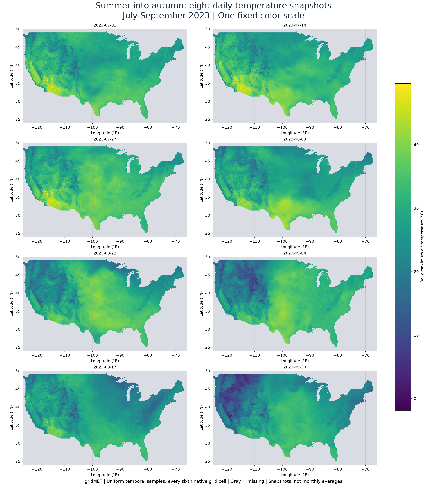
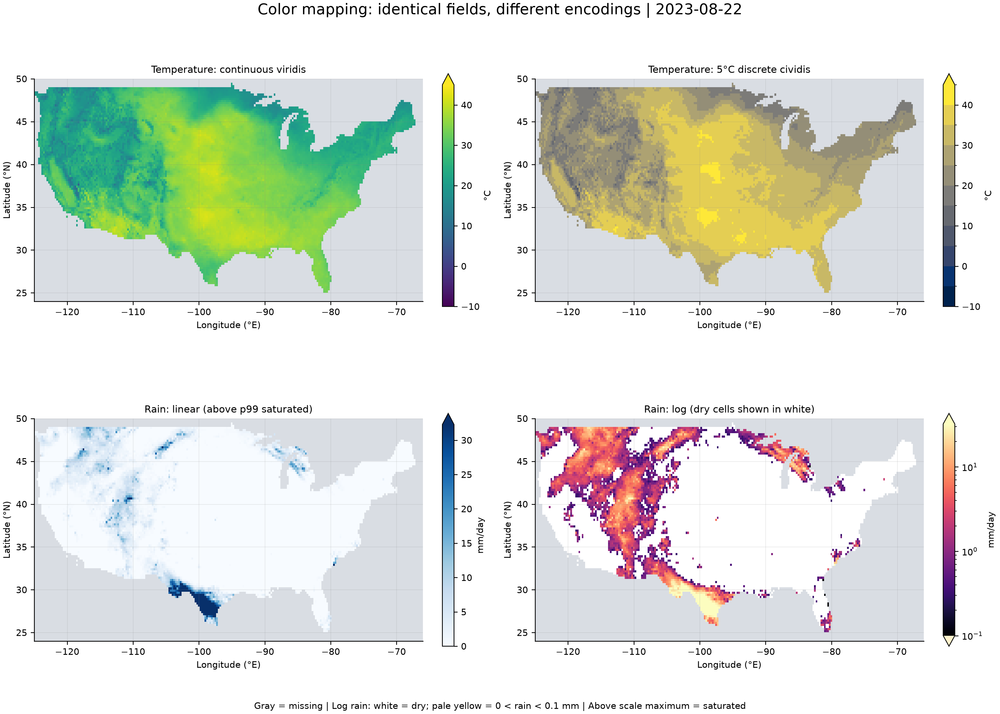
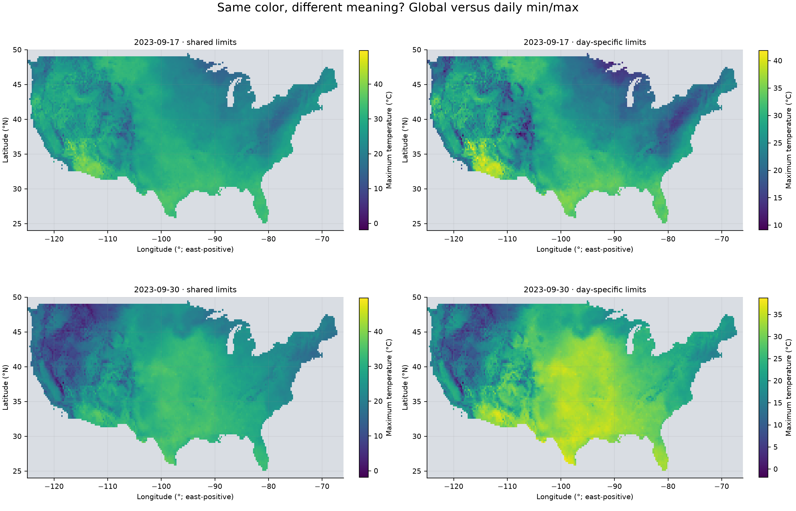
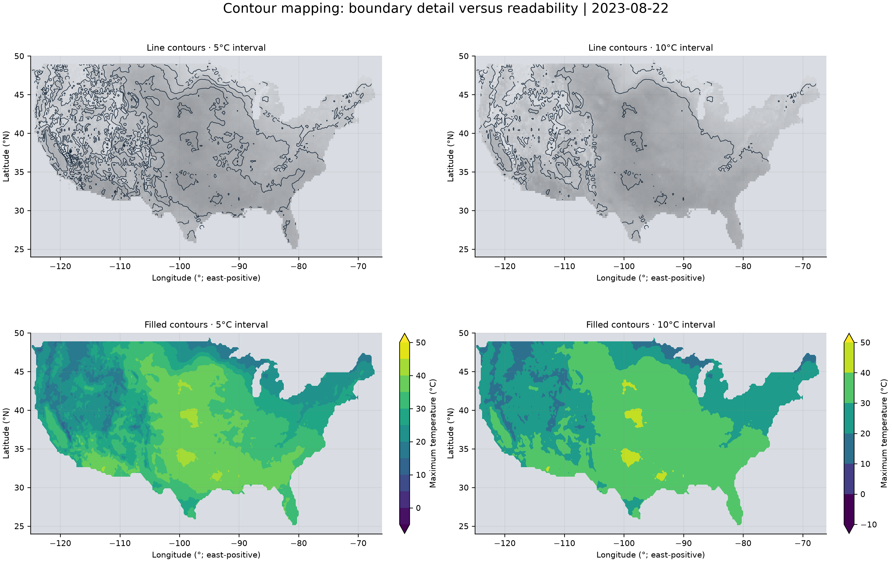
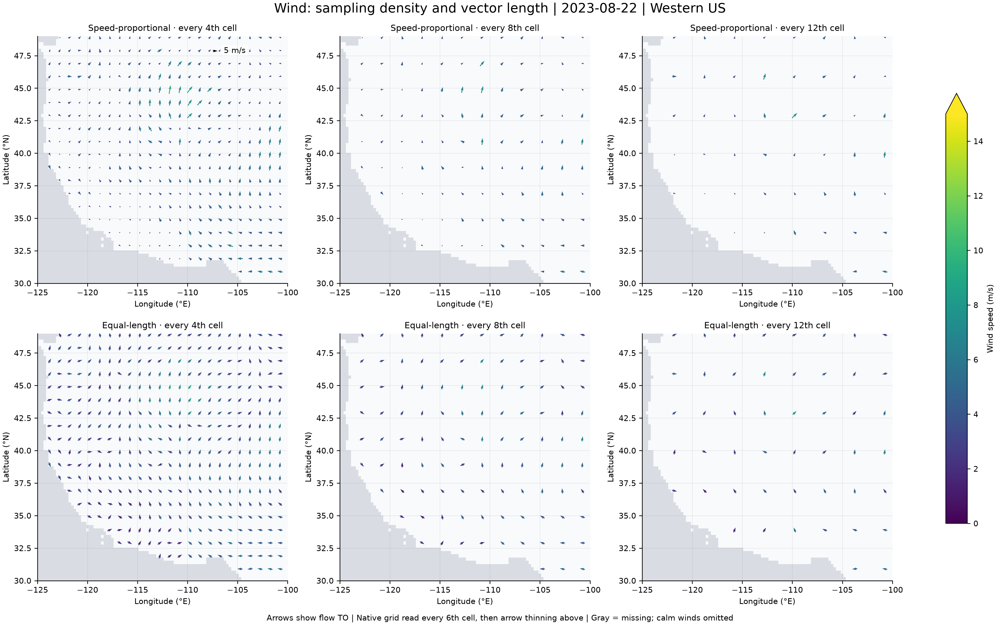
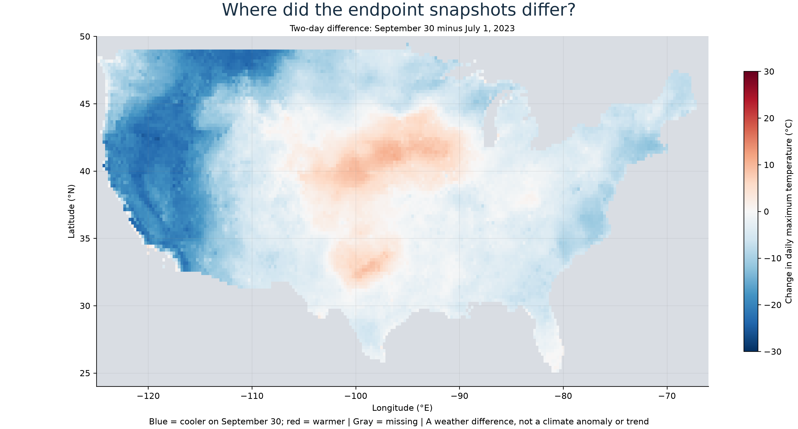

# gridMET results: July-September 2023

## SciVis: July-September 2023

The team-supplied interval contains 92 calendar days. Eight deterministic, uniformly spaced samples include both endpoints and avoid selecting only dramatic days. The base spatial stride is six native cells (0.25 degrees); it is subsampling, not averaging. Source packing and masks are decoded before converting K to Celsius. Current data are used: the owner records reprocessing of this interval in September 2024.

**Figure 11.** All eight snapshots use -1.85 to 49.65 °C. Gray means no data. Shared limits allow direct comparisons; eight dates cannot establish event duration or a seasonal trend.

**Figure 12.** Same fields on 2023-08-22. Temperature uses continuous viridis and 5 °C cividis classes. Of valid rain cells, 68.7% are dry and 0.00% have positive rain below 0.1 mm. Rain above 32.28 mm (1.01% of valid cells) saturates. The log panel assigns white to dry cells, pale yellow to positive rain below 0.1 mm, and gray to missing cells.

**Figure 13.** Global limits are actual minima/maxima over these eight subsampled fields. The narrowest daily span is 9.15 to 41.85 °C on 2023-09-17; the widest is -1.85 to 38.75 °C on 2023-09-30. Local scales improve within-date contrast but change the numerical meaning of the same color. Global here means the sampled space-time cube, not all 92 days or the whole Earth.

**Figure 14.** Same temperature field on 2023-08-22, compared at 5 and 10 °C intervals. Matplotlib/ContourPy serial grid-cell tracing uses the Marching Squares family. Lines trace equal-temperature boundaries; fills reveal broad regions. Coarse levels span the full sampled range. Interpolation smooths boundaries between available grid points; no finer-resolution measurements are created.

**Figure 15.** Same daily wind field on 2023-08-22. Columns retain every 4th, 8th or 12th display cell: nominal angular steps 1°, 2° or 3° after the base 0.25° subsample. Rows compare speed-proportional and equal-length arrows with identical speed colors (0-15 m/s; greater values saturated). Arrows point where air flows, not where wind comes from. Longitude/latitude bearings account for cosine latitude and the plotted aspect. Constant length makes weak winds visible but removes magnitude from length. Wind's coarser source limits terrain-scale inference.

**Figure 16.** On common valid sampled cells, approximately 81.4% of area is cooler on September 30 than July 1. The approximate area-weighted difference is -5.58 °C; individual cells range from -25.80 to 11.10 °C. Weights are cosine latitude. This two-day comparison is neither a seasonal average nor a climate anomaly.

Three eight-frame GIFs compare shared-scale temperature, daily-scale temperature, and fixed-level filled contours. The shared-scale version is preferred for between-date comparisons; local rescaling is an explicit experiment.

**Design rationale.** Sequential palettes encode ordered scalar values; 5 °C classes trade detail for readable bands. Log rain mapping expands weak-positive-rain contrast while requiring separate zero handling. A diverging palette is appropriate for signed endpoint differences, because zero has a physical meaning. Temperature itself is not treated as a zero-centered anomaly. In line contours, background lightness and labels support tracing; filled contours support regional comparisons. No experiment changes the underlying observations.

**Normalization and algorithm.** Global mapping uses (value - global minimum)/(global maximum - global minimum); local mapping substitutes that day's extrema. Contours are computed using the documented ContourPy serial implementation, not a custom algorithm. Grid-cell crossings are interpolated, with missing values masked and the library's default corner masking. The wind transform is u = -speed sin(theta), v = -speed cos(theta), for a clockwise-from-north source angle: north wind flows south, east wind flows west. Scalar speeds and directions are paired daily products; plotted arrows do not assert instantaneous trajectories.

**Verified data handling.** Automated checks pass for eight distinct dates, coordinate ordering, aligned array shapes, plausible physical ranges, nonnegative rain/speed, direction range, cardinal wind conversions, global min/max settings, and eight frames in each animation. Validation evidence is in data/scivis/findings_2023.json. Geographic axes are a longitude/latitude display, not an equal-area map; use documented cosine-latitude weights for the approximate area result.

Research and source links: research/JUL_SEP_2023_PLAN.md.
