# Beyond Averages and Snapshots

Connectivity Profiles and Daily Weather | Team Plot Twist | DAS732 Assignment 2

[Live dashboard](https://aithal007.github.io/DV_assignment2/)

## Abstract

What do averages and snapshots hide about inequality, relationships and change over time? We study country internet indicators and daily US weather separately. Network, multivariable, temporal and spatial views connect each question to measured evidence. Broadband and internet use correlate strongly across country levels (0.831), but weakly across their changes (0.054). About 47% of measured adoption variation lies within regions. Hot-dry conditions occupy 16.27% of weighted grid-cell days, yet local runs reach 67 days. These contrasts show why group summaries, endpoints and separate frequencies need individual values, histories and shared timing for interpretation.

## Introduction

A national adoption rate hides infrastructure differences; a regional mean hides its member countries; a monthly weather summary hides daily events. We use linked comparisons to recover that missing detail.

**Central question: What do averages and snapshots hide about inequality, relationships and change over time?**

We ask: (1) Do similar internet-use levels conceal different telecom profiles? (2) Does overall progress imply catch-up among the same countries? (3) What do weather averages and selected dates omit about location, event timing and duration? Country data answer the first two questions; the separate weather investigation answers the third. Each result is interpreted as a descriptive pattern in the included data, with its scope stated.

## Data and preparation

**Country inputs and cleaning.** Three A1 OWID/ITU CSV extracts [2] provide internet-user counts, internet-use percentages and telecom subscriptions. `scripts/preprocess_data.py` renames columns, checks source-key uniqueness and numeric types, then outer-joins the files on entity, country code and year with one-to-one validation. The join has 13,387 rows; removing 823 explicitly listed aggregate rows leaves 12,564 country-year records. Missing values remain missing: they are neither replaced with zero nor imputed. A separate code-based lookup supplies regions; unmapped entries remain Unclassified.

**Comparable cohorts and transformations.** Each task declares its complete cases: 179 countries with all four 2020 profile indicators for the network; the same 175 countries in both 2015 and 2020 for paired changes; 159 countries with all 21 annual adoption values for 2000-2020; and 184 countries with user counts and adoption for treemaps. A change is computed within country before summarizing. Internet use is a percentage of people; landline, broadband and mobile values are subscriptions per 100 people and may exceed 100. These units are retained in profiles and changes.

**Professor's guidance and network construction.** Following the professor's advice, we score every country pair, inspect the similarity distribution and filter highly similar pairs. Four indicators are z-scored separately across the 179 countries: subtract the indicator's country mean and divide by its standard deviation. Euclidean distance d gives similarity s=1/(1+d). Our team chooses the 95th percentile, P95=0.569763, as the sparse default: 797 of 15,931 pairs remain, with all 179 nodes retained. P95 is our team's choice. Figure 1 explains that choice and its sensitivity.

**Weather period and sampling rationale.** gridMET [1] supplies `tmmx` (daily maximum temperature), `pr` (rain), `vs` (wind speed at 10 m) and `th` (wind FROM-direction at 10 m). July-September spans peak summer into early autumn, allowing heat persistence, cooling and rain timing to be compared in one contiguous interval. The selected 2023 year includes independently documented Southwest July heat [9], making persistence substantively relevant; it is a case study, not a representative climate year. Uniform eight-date sampling, 13 days apart with both endpoints, gives reproducible seasonal coverage without the uneven gaps possible in a small random sample. It cannot ensure capture of short extremes; all 92 days support monthly/event inferences.

**Weather preparation.** Decode NetCDF packing/masks before converting source Kelvin to Celsius; supplied caches are already Celsius. Read every sixth grid cell (subsampling, not averaging), align coordinates/dates and retain the same 13,416 cells valid for all variables on all days. Cosine-latitude weights approximate area. Rain stays mm/day, speed m/s and direction degrees FROM north; quiver components point toward flow. The audit records hashes, missing counts, cohorts and sampled-to-daily checks.

### Tools, interaction and evidence

NetworkX [3] computes the three layouts; D3 [4] implements layout/threshold selection, node filters, PCP bundling/brushing/reordering and treemap zoom/hierarchy/partition controls. Gephi [5] is an allowed alternative, not a required additional tool. The first-page dashboard link opens the working browser UIs; `images/gui/` and the interaction receipt provide local evidence. Open `web/home.html` through `python run_visualizations.py` to exercise the controls locally. The README documents setup, reproduction and browser checks.

## Country relationships and paths

We establish how links are constructed, compare country histories and inspect relationships hidden inside a community.

### Figure 1. Complete pair similarities, threshold selection and three layouts.

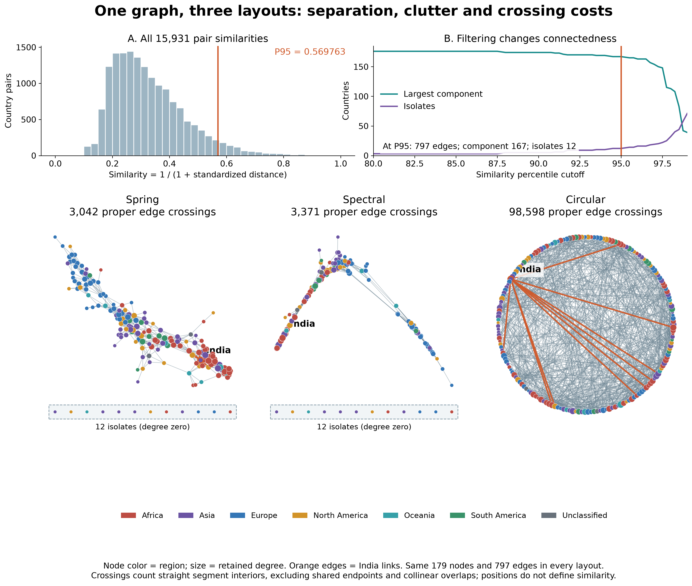

**Question.** How can a dense complete similarity network be filtered transparently before comparing layouts?

**Encoding.** Cohort: 179 complete four-indicator profiles in 2020; no 2015 completeness is required. The histogram counts all unique country pairs. The second panel sweeps percentile cutoffs from P80 to P99 and counts countries in the largest connected component and countries with no retained edge. The vertical lines mark P95. The lower panels draw the same 797 retained edges with Spring, Spectral and Circular positions; India and its twelve links are highlighted.

**Why this chart.** The full similarity distribution makes the filtering decision visible instead of silently imposing nearest neighbors. Three layouts then test representation effects on one fixed threshold graph. A shared threshold treats every country pair by the same rule.

**What it shows.** The distribution defines the complete 15,931-pair universe. P95=0.569763 retains 797 edges and all 179 countries, including 12 isolates. This is the team's sparse default; P90/P92.5/P97.5 retain 1,594/1,195/399 pairs and 5/9/22 isolates. The labeled rows deliberately place degree-zero countries.

All layouts preserve India's twelve links. Spring separates the connected core with relatively short edges; Spectral compresses some neighborhoods and can overlap nodes; Circular preserves a uniform node order but creates long, crossing chords. Proper straight-edge crossings are 3,042/3,371/98,598 for Spring/Spectral/Circular. These display-specific counts exclude shared endpoints and collinear overlaps; they are readability measures, not evidence that one graph is truer. Region color and degree size expose composition and connectivity. The package's `output/network_revision/` contains the threshold sweep and metric-sensitivity tables; `output/review_revision/layout_comparison.csv` defines the layout comparison.

**Takeaway.** Filtering makes the complete pair network readable, but also changes connectedness. P95 keeps 797 edges and 12 isolates; the three layouts preserve those relationships. Infer similarity from scores and edges, while treating layout proximity and isolated placement as display choices.

[View live demonstration](https://aithal007.github.io/DV_assignment2/web/network.html) | [Full UI screenshot](https://aithal007.github.io/DV_assignment2/interactions.html#network)

### Figure 2. Different country paths to higher internet use.

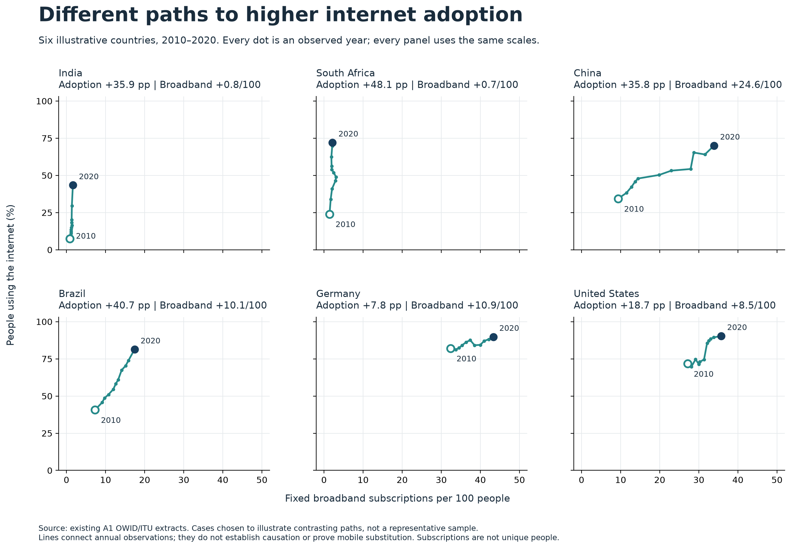

**Question.** Can internet use rise without a similar rise in fixed broadband?

**Encoding.** Each panel follows one country from 2010 to 2020. Open dots mark 2010 and dark dots mark 2020. Small dots show the intervening years. All panels use the same axes.

**Why this chart.** The network compares countries in one year. Small multiples add the history it leaves out. Each country gets its own panel, so its annual path can be followed without crossing five other paths. Shared axes make the size and direction of the changes comparable across countries.

**What it shows.** The six panels do not follow one shared adoption-broadband path. South Africa gains 48.1 percentage points in internet use with only 0.7 additional fixed-broadband subscriptions per 100 people, whereas China gains 35.8 points with 24.6 additional subscriptions. India similarly gains 35.9 points with a broadband increase of 0.8. The vertical separation of their start/end markers and different horizontal displacements are the visible evidence.

This answers the history part of the main question: an endpoint or even a similar adoption gain cannot identify the associated infrastructure trajectory. Germany's smaller adoption gain also begins from an already high 82% level, so raw gains need starting-level context. These six stated examples illustrate heterogeneity; they do not establish whether mobile access, investment or another mechanism caused it.

**Takeaway.** Similar adoption progress can accompany different infrastructure histories. The contrasting country paths show that a 2020 endpoint cannot establish how a country reached it; annual paired observations are needed to distinguish those histories.

[View figure and interpretation online](https://aithal007.github.io/DV_assignment2/figures.html#fig2)

### Figure 3. Community links and degree-ordered pair detail.

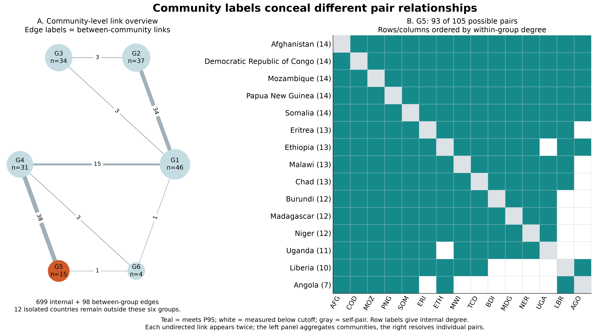

**Question.** Which individual relationships are hidden by the grouped threshold graph?

**Encoding.** Left: six aggregate community nodes, sized by country count, with between-community edge counts. Right: the selected 15-country adjacency matrix, ordered by descending internal degree. Teal means above cutoff, white below, gray self-pair.

**Why this chart.** Matrix cells make exact retained pairs and gaps checkable without relying on crowded lines. The detail group is selected reproducibly as the smallest group with at least five countries that is not a clique. Isolates are explicitly reported rather than silently dropped.

**What it shows.** The left graph aggregates six communities, making their 98 between-group links readable; the 699 internal links remain inside the groups. The right matrix resolves the selected 15-country group, with 93 of 105 possible links. Rows and columns are now ordered by internal degree, so dense members and gaps are visible without decoding miniature overview matrices.

Afghanistan has 14 internal neighbors and Angola seven: a shared group label conceals different pair relationships. White cells are measured scores below P95; the diagonal is excluded. This node-link/matrix hybrid is inspired by NodeTrix [8], while community nodes in the overview are aggregates. The exact matrix supplies the individual evidence that the grouped picture omits.

**Takeaway.** A community label hides unequal relationships among its members. The enlarged matrix contains 93 of 105 possible links, with uneven row degrees and real gaps. Inspect those pairs before treating a network community as one uniform telecom profile.

[View figure and interpretation online](https://aithal007.github.io/DV_assignment2/figures.html#fig3)

## Profiles, changes and hierarchies

We connect paired changes and endpoint profiles, directly test almost equal adoption, then compare associations and user-count hierarchies.

### Figure 4. Similar internet gains, different infrastructure changes.

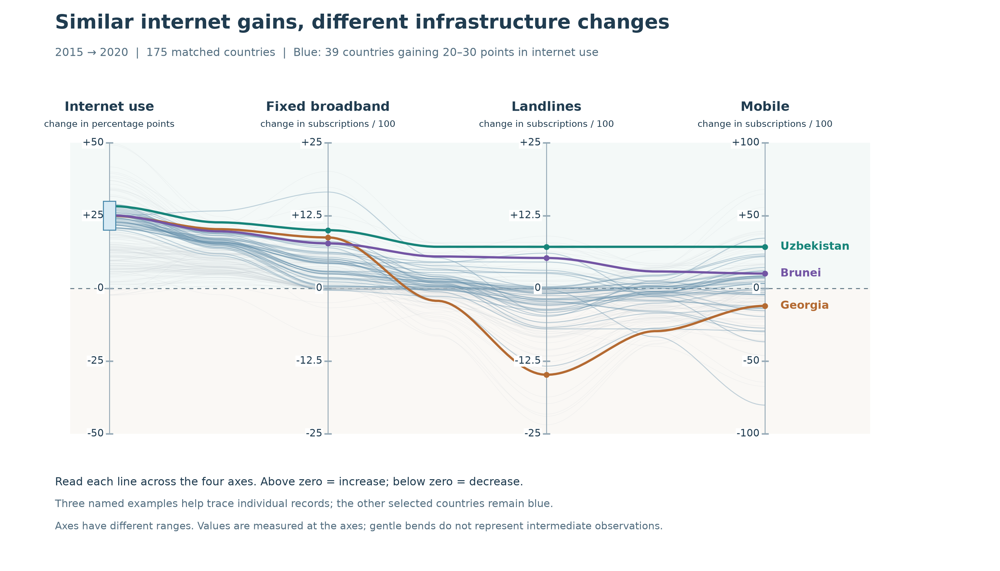

**Question.** Do countries with similar gains in internet use also have similar changes in their telecom indicators?

**Encoding.** Cohort: the same 175 countries complete in both 2015 and 2020; four other 2020-complete countries lack complete 2015 profiles. Each line connects one country's four changes from 2015 to 2020. At every axis, change is calculated as the 2020 value minus its 2015 value. Internet use changes in percentage points; the other axes show changes in subscriptions per 100 people. All 175 matched countries remain visible. Blue highlights the 39 countries that gained 20-30 percentage points in internet use; gray retains the other 136. Three selected examples are named and colored separately. The dashed horizontal line aligns zero on all four axes: above it means an increase and below it a decrease. Each axis has its own stated range.

**Why this chart.** The annual paths in Figure 2 compare internet use and broadband for six examples. This parallel-coordinate view connects all four changes for the full matched sample, so one country can be followed across several measures. Brushing a common range of internet gains asks what else changed among countries making broadly similar progress. Thin background lines retain the full sample, while three named records make the selected pattern easier to trace. The browser supports brushing, axis reordering, hover values and a straight-versus-gently-bundled comparison.

**What it shows.** The gain brush selects 39 of the same 175 matched countries. Within this 20-30-point adoption band, broadband changes span about -0.3 to +16.6, landlines -14.8 to +7.1 and mobile -80.2 to +34.5 subscriptions per 100. One adoption-gain interval therefore conceals several infrastructure transitions.

Georgia and Brunei both gain about 25 adoption points and eight broadband subscriptions, yet their landline/mobile changes are -14.8/-12.0 versus +5.2/+10.2. Uzbekistan gains 28.3 adoption points, 10.0 broadband, 7.1 landline and 28.6 mobile subscriptions. Its positive movement on all four axes contrasts with the other named cases. Read at axis intercepts; bundled joins are tracing aids [10].

**Takeaway.** Similar internet-use gains conceal different combinations of infrastructure change. Even the selected 20-30-point gain group contains opposing landline and mobile movements. Follow each country across all four change axes before assigning one explanation to its progress.

[View live demonstration](https://aithal007.github.io/DV_assignment2/output/pcp_changes/index.html) | [Full UI screenshot](https://aithal007.github.io/DV_assignment2/interactions.html#changes)

### Figure 5. Gentle bundles reveal different country profiles.

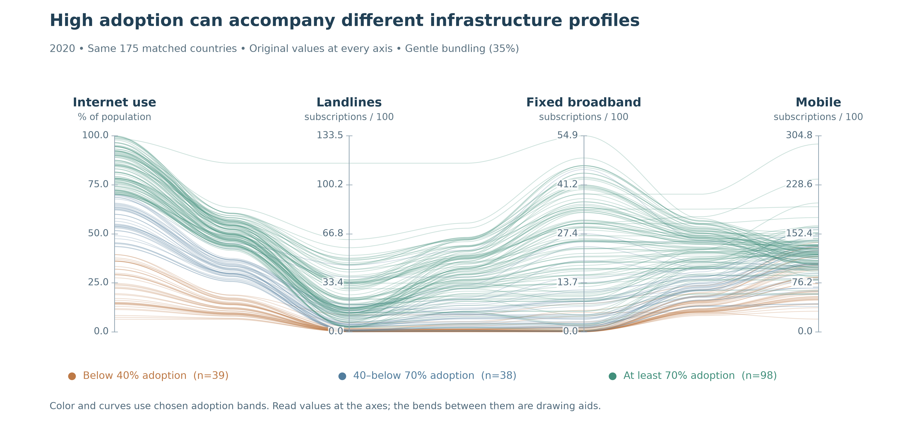

**Question.** Do countries with high internet use share the same infrastructure profile?

**Encoding.** Cohort: the same 175 countries complete in both 2015 and 2020; four other 2020-complete countries lack complete 2015 profiles. Each curve is one of the same 175 countries in 2020. The four vertical axes retain their original units and full matched-country ranges. Orange means below 40% internet use, blue means 40-below-70%, and green means at least 70%. Within each chosen band, curves bend gently toward the average profile between neighboring axes. The 35% setting preserves every measured axis intersection and keeps each bend between its two endpoint values. These bands are chosen comparison groups, not discovered country types.

**Why this chart.** Parallel coordinates keep four measurements connected for each country. Thin curves and three consistent colors make the full set easier to follow without replacing records with filled ribbons. Figure 4 compares five-year changes; this figure compares the country profiles at the 2020 endpoint. The two PCPs therefore ask different questions using the same matched countries. The browser lets the reader compare straight and bundled paths, brush ranges, reorder axes and inspect country values.

**What it shows.** The high-adoption curves fan out strongly on fixed broadband. Kuwait has about 99.1% internet use with 1.7 broadband subscriptions per 100 people; Kyrgyzstan has 72.0% with 4.3. Mobile values also overlap across the three adoption bands instead of separating them cleanly. These are visible exceptions to the idea that one headline adoption category has one infrastructure profile.

Read values where each curve meets an axis. Gentle bundling uses the declared adoption bands to help trace records [10], while the joins between axes are drawing aids. This plot addresses endpoint composition; the preceding change plot addresses transition. Together they distinguish a similar present state from a similar history. The data do not measure all alternative access technologies or identify a causal route to connectivity.

**Takeaway.** High adoption describes several infrastructure profiles rather than one common model. Overlapping mobile values and widely differing broadband values within the same adoption band show why the headline rate must be read alongside the other indicators.

[View live demonstration](https://aithal007.github.io/DV_assignment2/web/index.html) | [Full UI screenshot](https://aithal007.github.io/DV_assignment2/interactions.html#pcp)

### Figure 6. Similar adoption can hide different infrastructure.

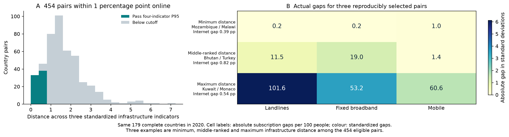

**Question.** How much can infrastructure differ when internet-use rates almost match?

**Encoding.** Cohort: 179 complete four-indicator profiles in 2020; no 2015 completeness is required. Panel A counts pairs within one percentage point in internet use. Panel B shows three pairs selected by minimum, middle-ranked and maximum infrastructure distance. Labels give absolute subscription gaps per 100 people; colour gives standardized gaps.

**Why this chart.** This links an almost equal headline rate to the infrastructure detail it conceals. The histogram retains all eligible pairs, while the examples make the gaps tangible.

**What it shows.** Among 454 pairs whose adoption differs by at most one percentage point, only 71 (15.6%) meet the full-profile P95 cutoff. The histogram's horizontal distance uses only standardized landline, broadband and mobile gaps; the pass/fail color uses the network's four-indicator similarity, including adoption. The definitions differ deliberately because the question conditions on nearly equal adoption.

The three examples span minimum, middle-ranked and maximum infrastructure distance. Bhutan/Turkey differ by 0.82 adoption points but 19.0 broadband subscriptions per 100; Kuwait/Monaco show much larger infrastructure gaps despite a 0.54-point adoption gap. Raw gap labels and standardized colors separate absolute size from relative unusualness. Similar headline rates therefore do not establish similar full profiles.

**Takeaway.** Almost equal adoption rates can conceal substantially different infrastructure. Only 71 of 454 eligible pairs meet the full-profile cutoff. The headline percentage therefore cannot substitute for a country profile, even when two values nearly match.

[View figure and interpretation online](https://aithal007.github.io/DV_assignment2/figures.html#fig6)

### Figure 7. Four telecom measures: associations and exceptions.

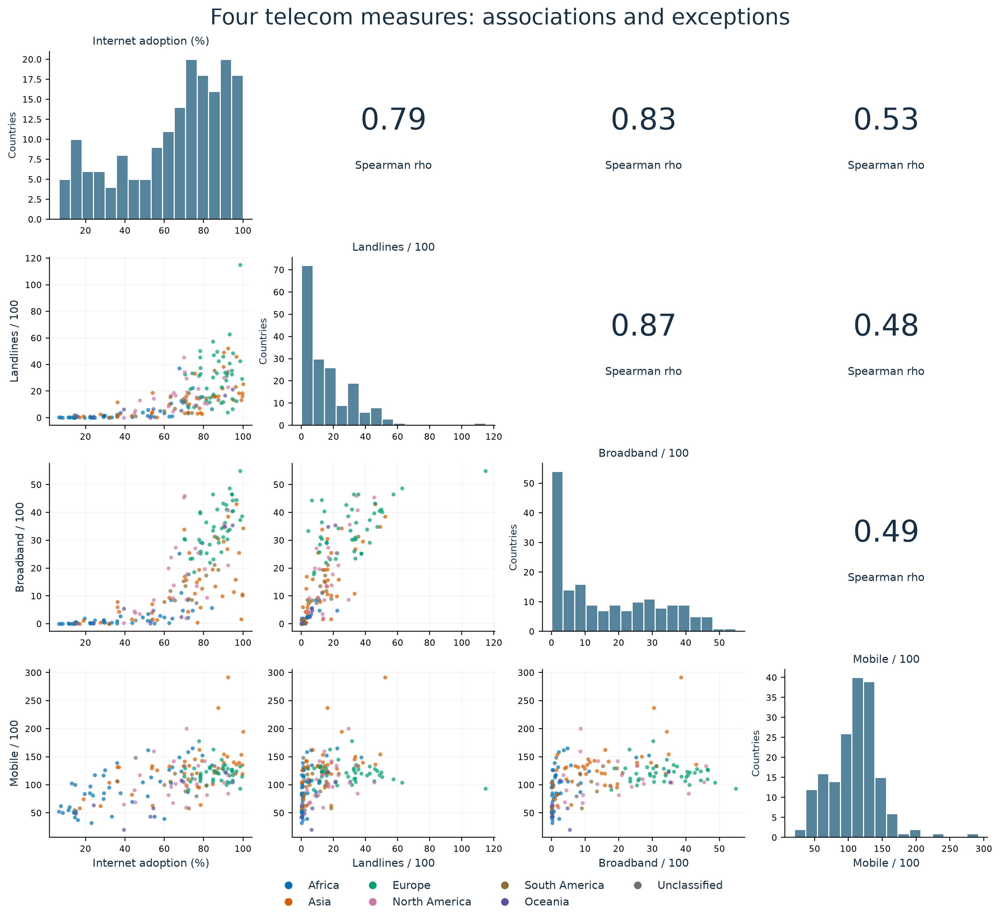

**Question.** What does the complete set of pairwise relationships reveal?

**Encoding.** Cohort: the same 175 countries complete in both 2015 and 2020; four other 2020-complete countries lack complete 2015 profiles. The four variables occupy the same row and column order: internet use, landlines, fixed broadband and mobile. Diagonal cells are country-count histograms. Below the diagonal, each dot is one country, with the column variable on the horizontal axis and the row variable on the vertical axis. Color shows region. Above the diagonal, the matching pair has its Spearman rank-correlation value. All cells use the same 175 countries in 2020.

**Why this chart.** The two adoption scatterplots in A1 already compared broadband and mobile. Restoring the full scatterplot matrix adds the four other pairs, the individual distributions and a common sample. Each relationship can be checked in its own scatter cell rather than inferred from a single correlation number. This also gives a position-based check on the four-variable parallel-coordinate profiles.

**What it shows.** The lower scatter cells show tighter upward ordering for broadband versus adoption (Spearman 0.83) than for mobile versus adoption (0.53). Landlines and broadband have the strongest displayed pairwise rank association, about 0.87. The clouds and outlying countries qualify those coefficients: high adoption still occurs at low fixed-broadband values, and mobile subscriptions overlap widely.

All cells use the same 175 countries, so different sample membership does not explain the contrast. Diagonal distributions also show why a subscription count can exceed 100 per 100 people without being an adoption percentage. This tests the profiles seen in parallel coordinates using ordinary position axes. It supports an association between 2020 country levels, while leaving causal explanations and country-specific change unresolved.

**Takeaway.** A correlation summarizes an association while hiding its exceptions and shape. The scatter cells show stronger adoption association with broadband than mobile, yet substantial variation remains. These endpoint associations do not identify the drivers of country progress.

[View figure and interpretation online](https://aithal007.github.io/DV_assignment2/figures.html#fig7)

### Figure 8. Country levels and country gains tell different stories.

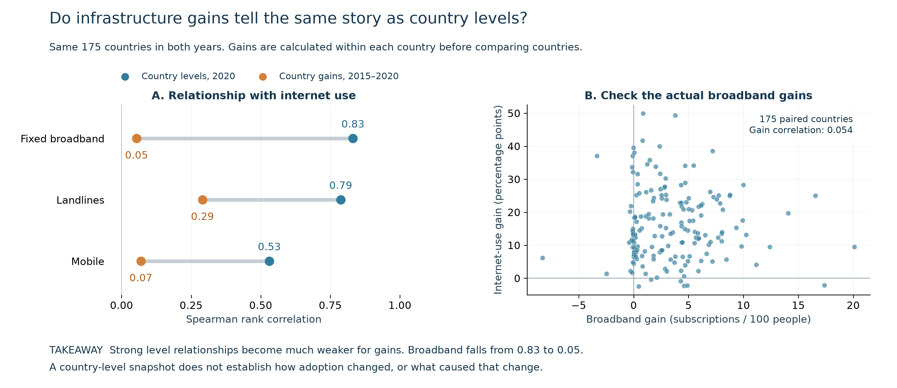

**Question.** Does a strong relationship between country levels also hold for gains within the same countries?

**Encoding.** Cohort: the same 175 countries complete in both 2015 and 2020; four other 2020-complete countries lack complete 2015 profiles. The left panel compares Spearman rank correlations with internet use for fixed broadband, landlines and mobile. Blue dots use 2020 country levels; orange dots use each country's 2020-minus-2015 gains. Each gray line joins the two correlations for one measure. The right panel shows the actual broadband and adoption gains, with one dot per country. Both comparisons use the same 175 complete country pairs. Correlation describes how consistently two variables increase together across countries.

**Why this chart.** Figure 7 shows relationships between country levels. Repeating the comparison after calculating each country's gain tests whether that snapshot relationship carries over to progress. The paired-dot chart compares all three measures without repeating six scatterplots. The broadband-gain scatterplot keeps the underlying observations visible, so the coefficients can be checked against the shape of the data.

**What it shows.** Across the same 175 countries, broadband-adoption rank association falls from 0.83 in 2020 levels to 0.054 in paired 2015-2020 gains. The gain scatter lacks the ordered upward pattern suggested by the endpoint coefficient. Landline and mobile associations similarly weaken, from 0.79 to 0.29 and 0.53 to 0.07.

This changes the analytical question, not the cohort: countries already at high infrastructure levels differ from those adding most within five years. Adoption is bounded at 100%, so high-baseline countries also have less possible gain; saturation and diffusion timing can affect these contrasts. The figure supports separating levels from gains, not concluding that infrastructure is unimportant.

**Takeaway.** Countries that have more broadband tend to have higher adoption, but countries gaining more broadband do not show the same ordering of adoption gains. The fall from 0.83 to 0.05 exposes why a cross-country snapshot cannot substitute for paired change.

[View figure and interpretation online](https://aithal007.github.io/DV_assignment2/figures.html#fig8)

### Figure 9. Internet users grouped by region.

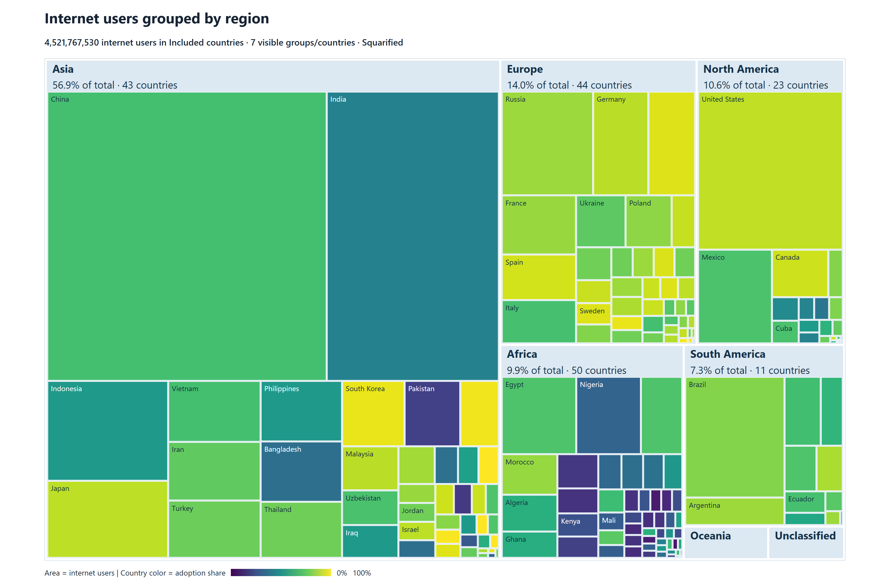

**Question.** Where are the included internet users concentrated?

**Encoding.** Large rectangles are regions; smaller country rectangles sit inside them. Area shows the number of internet users. Country color shows the percentage of people online. Group headers show each region’s share of the included total.

**Why this chart.** A country with a high internet-use rate can still have fewer users than a large country with a lower rate. The nested treemap separates these two quantities: area shows the count and color shows the rate. Region-first grouping answers where the included users live, while keeping countries inside their regions.

**What it shows.** Asia occupies about 56.9% of the included internet-user total, compared with 14.0% in Europe. China and India are large country rectangles because user counts are large; their colors can differ because adoption percentages measure a separate quantity. The total denominator is the same 184-country, 4,521,767,530-user sample, not an estimate covering every missing country.

This answers where included users are concentrated while showing why a large user population does not imply near-universal access. Zooming into Asia reveals country counts and rates hidden by its regional area. The live spatial-partition control also compares squarified rectangles with slice-and-dice strips; values and hierarchy remain fixed while geometry changes. Compare encoded values, not a country's apparent visual prominence alone.

**Takeaway.** A large internet-user count can coexist with incomplete population access. Asia holds 56.9% of included users, but rectangle size alone says nothing about adoption percentage. Read count area and country color together to distinguish scale from access.

[View live demonstration](https://aithal007.github.io/DV_assignment2/web/treemap.html) | [Full UI screenshot](https://aithal007.github.io/DV_assignment2/interactions.html#treemap)

### Figure 10. The same users grouped by adoption band.

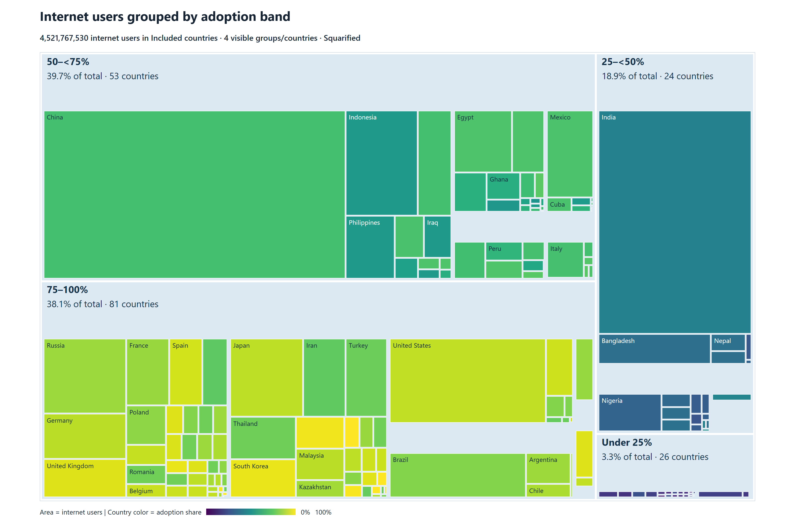

**Question.** Does changing the hierarchy change the comparison?

**Encoding.** This treemap uses the same 184 countries and total as Figure 9. It first groups countries by internet-use band, then by region. Area still shows user count and country color still shows internet use.

**Why this chart.** The first treemap makes regional size prominent. Reversing the hierarchy asks which adoption levels contain those users. Keeping the country data, total area and color scale fixed isolates the effect of grouping. The two trees therefore answer different questions with the same records.

**What it shows.** Moving adoption band to the top exposes a different composition of the same user total: the 50-below-75% band contains about 39.7% of included users, slightly more than the 38.1% in the 75-100% band. Thus a large share of online people live in countries where a substantial part of the population remains offline.

No country values change when the hierarchy switches. The difference from the region-first view comes from which grouping is made visually prominent. This is evidence that aggregation design changes the question a summary answers. A rectangle represents online users, not offline population, so the plot does not directly count the access shortfall. The live partitioning comparison changes shapes only; zooming changes the displayed denominator, which is stated in the status and breadcrumb.

**Takeaway.** The distribution of users across adoption levels becomes visible when the hierarchy changes. The 50-below-75% band contains 39.7% of included users, so many online users live where substantial access gaps remain. Grouping changes the question answered by the same values.

[View live demonstration](https://aithal007.github.io/DV_assignment2/web/treemap.html) | [Full UI screenshot](https://aithal007.github.io/DV_assignment2/interactions.html#treemap)

## Progress, inequality and timing

Fixed country identities distinguish progress from catch-up; distributions and trajectories retain the differences behind regional summaries.

### Figure 11. Did countries that started behind catch up?

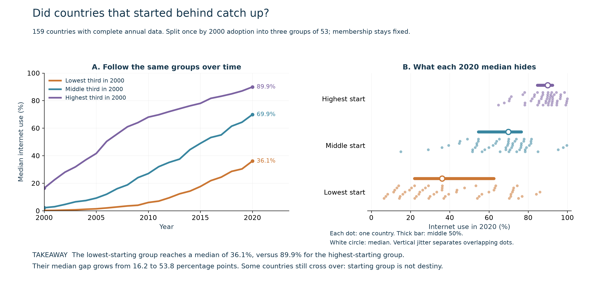

**Question.** Did the countries with the lowest initial internet use catch up as overall adoption rose?

**Encoding.** The 159 countries with complete 2000-2020 records are ranked once by their internet use in 2000 and divided into three groups of 53. Orange is the lowest starting third, blue the middle third and purple the highest third. Membership stays fixed in every year. The left panel follows each group's yearly median. The right panel shows every country's 2020 value; the thick bar spans the middle half and the white circle marks the median. Small vertical offsets separate overlapping country dots and have no data meaning.

**Why this chart.** Yearly distributions can improve even when the countries that started behind remain behind. Keeping the same initial groups follows those countries instead of replacing them with whichever countries occupy a percentile later. The median paths show the group contrast over time; the individual dots prevent a group summary from hiding exceptions. This complements the later ridgelines, which compare overall and regional distributions.

**What it shows.** All fixed cohorts progress, but the lowest-start group ends at a median 36.1% adoption and the highest at 89.9%. Their absolute median gap rises from 16.2 to 53.8 percentage points. Fixed 2000 membership rules out changing cohort labels as the source of widening; overlapping endpoint dots retain individual exceptions.

This is an absolute percentage-point comparison. Bounded adoption and different positions on an S-shaped diffusion path can widen absolute gaps during a transition even while relative measures fall. High-start countries have less remaining headroom. The chart establishes broad progress without absolute median catch-up over this interval; it does not establish that every definition of inequality worsens.

**Takeaway.** Broad progress does not imply absolute catch-up. All fixed starting groups improve, yet their low-to-high median gap widens from 16.2 to 53.8 points. Fixed membership establishes that this contrast is not created by moving countries between groups.

[View figure and interpretation online](https://aithal007.github.io/DV_assignment2/figures.html#fig11)

### Figure 12. Country differences inside each region.

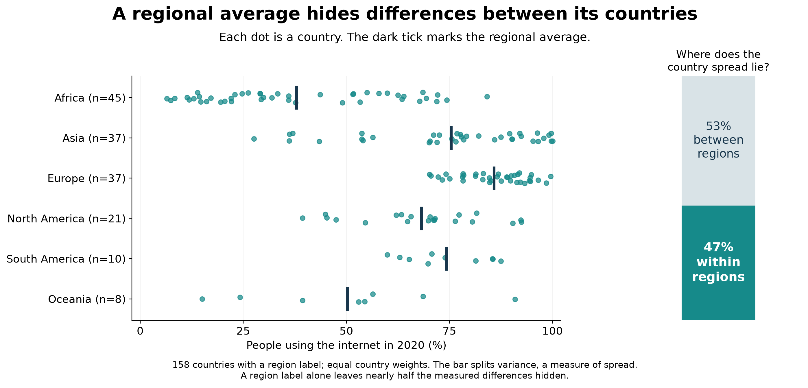

**Question.** How much country variation does a regional average leave hidden?

**Encoding.** Each dot shows one country’s 2020 internet-use rate. A dark tick marks the regional average. The bar on the right divides the total spread into differences within regions and differences between regional averages.

**Why this chart.** A regional mean is one mark, even when its countries are far apart. Showing every country beside that mark reveals the spread directly. The variance split then gives a single numerical answer to how much of the total country variation sits inside regions. This extends the regional comparison without repeating A1's absolute-gap and ratio plots.

**What it shows.** The country dots spread widely around several regional averages. Variance decomposition assigns about 47% of measured adoption variation to differences within regions and 53% to differences between their means. This calculation uses the 158 region-classified members of the balanced country panel; the unclassified member is not silently assigned to a region.

The bars quantify what the dots make visible: a regional mean leaves nearly half of this measured country-level variation unresolved. Region therefore provides context without identifying the situation of each member. The decomposition weights regional mean contributions by country count and treats countries equally. It neither attributes 53% of outcomes causally to region nor describes the share of people who have access. This is why regional progress must be interpreted alongside individual values.

**Takeaway.** Regional averages leave substantial country inequality unresolved. The 47% within-region variance share and the individual dots show that a regional label cannot stand in for its members. Preserve country-level spread when interpreting an improving regional summary.

[View figure and interpretation online](https://aithal007.github.io/DV_assignment2/figures.html#fig12)

### Figure 13. Regional change and individual country gains.

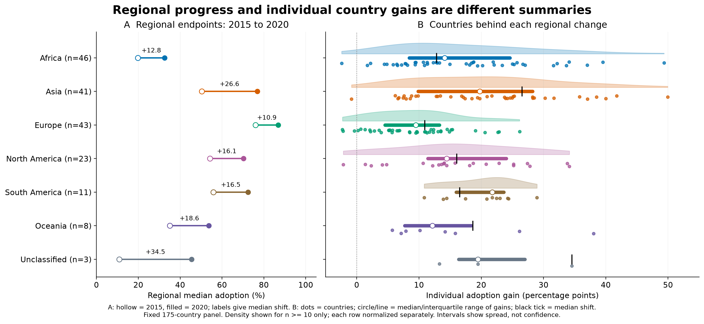

**Question.** Does the change in a regional median describe a typical country’s gain?

**Encoding.** The left panel shows 2015 and 2020 regional medians. The right panel shows each country’s own gain. A thick line marks the middle half of gains; the open circle is the median gain. The black tick repeats the shift in the regional median.

**Why this chart.** Subtracting two regional medians sounds like the typical country's gain, but the middle country can change between years. The paired endpoint view shows the regional summaries, and the gain view calculates change for each country first. Putting the two calculations together exposes the difference instead of asking the reader to infer it from separate tables.

**What it shows.** Asia's endpoint median shifts by 26.55 adoption points, but the median of its individual country gains is 19.75. South America reverses the relative comparison: its endpoint-median shift is 16.54 while its median country gain is 21.76. The visible separation between the black shift tick and open gain marker exposes the difference between these calculations.

The same countries are matched across 2015/2020. Subtracting two separately computed medians need not track one country's experience because the countries defining the middle may change. The gain dots additionally preserve Asia's wide range, about -0.84 to +49.94 points. This answers what a regional trend hides: both the distribution of progress and the distinction between summary movement and a typical paired change. Neither operation identifies causes.

**Takeaway.** A shift in a regional median is a different quantity from a typical country gain. Asia gives 26.55 versus 19.75 points. Calculate paired changes first when the question concerns individual progress; summarizing first can change the answer.

[View figure and interpretation online](https://aithal007.github.io/DV_assignment2/figures.html#fig13)

### Figure 14. Country horizon plots.

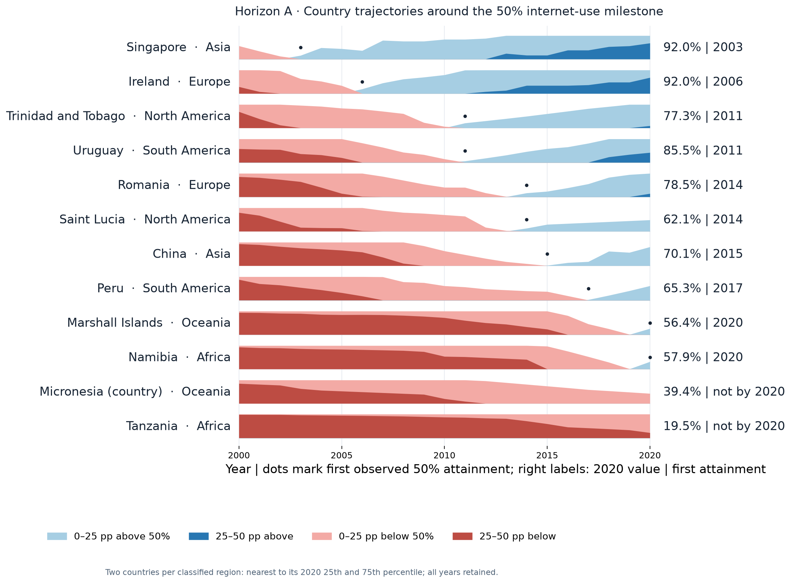

**Question.** Which countries reach majority internet use early or late?

**Encoding.** Each row follows one selected country from 2000 to 2020. Red means below 50% internet use and blue means above it. Darker bands mean a larger distance from 50%. Right labels show the 2020 value and first observed 50% year.

**Why this chart.** Many full-size time-series panels would take more space. Horizon rows fold values around a meaningful 50% reference, keeping all 21 years in a compact display. Sorting by first crossing makes early and late arrivals easy to scan. The numerical endpoint labels help read values that are harder to recover from folded bands.

**What it shows.** The ordered rows show different first observed majority-use years: Singapore reaches 50% in 2003, Ireland in 2006, China in 2015, Peru in 2017 and Namibia in 2020; Tanzania and Micronesia have no observed crossing by the endpoint. Those differences remain visible even where eventual adoption rates might look comparable.

Red/blue encodes position below/above the fixed 50% reference; darkness distinguishes 25-point folded bands. A red row can still be rising rapidly. Annual sampling identifies the first recorded crossing year, not the precise date within that year. Two countries per classified region are selected by a stated endpoint-quartile rule. These examples recover timing hidden by a snapshot without pretending to represent every country or to measure growth directly from hue.

**Takeaway.** The same final adoption level can hide different arrival times. Horizon rows preserve early, late and absent crossings of the 50% milestone. Their colors describe position relative to that reference; they do not by themselves indicate growth or decline.

[View figure and interpretation online](https://aithal007.github.io/DV_assignment2/figures.html#fig14)

### Figure 15. Regional median horizon plots.

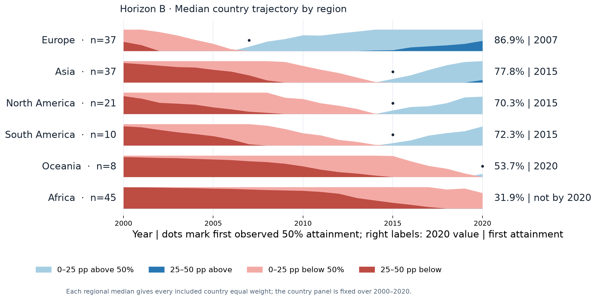

**Question.** Do regional medians reach majority use at similar times?

**Encoding.** Each row shows the yearly median internet-use rate for one region. The 50% reference and band colors match Figure 14. The same countries are used in every year.

**Why this chart.** Repeating the horizon design for regional medians tests how much the story changes after aggregation. The same reference and colors allow a direct comparison with Figure 14. One compact row per region makes broad timing clear, while the preceding country plots show what each regional row leaves out.

**What it shows.** Europe's regional median ends at 86.86%, Africa's at 31.89%, and Oceania's at 53.71% (53.7% rounded, matching the 2020 median in Figure 17). The fixed 50% reference makes crossing time and endpoint level comparable; red means below majority access, not decline.

Each row is one regional median, so the roughly 55-point Europe-Africa endpoint gap compresses the variation among their countries. Fixed classified-country membership prevents changing coverage from creating the trajectories. Enlarging the regional horizon makes the endpoint labels readable; the regional ridgelines then recover the spread around each median.

**Takeaway.** Regional trajectories make broad timing differences clear while compressing member histories. The large Europe-Africa median gap does not describe every country in either region. Read these summaries with country horizons and within-region spread before generalizing.

[View figure and interpretation online](https://aithal007.github.io/DV_assignment2/figures.html#fig15)

### Figure 16. How the country distribution changed.

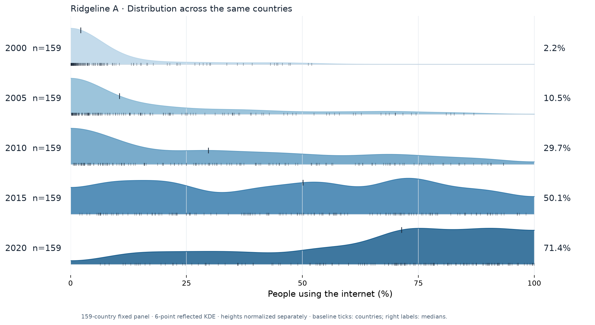

**Question.** Did all countries move toward similar internet use?

**Encoding.** Each ridge shows the distribution of internet use across the same 159 countries in one year. All ridges share the 0–100% scale. Small ticks show countries, and right labels give the median.

**Why this chart.** A rising median could mean that countries moved together or that some moved much faster than others. Ridgelines retain the whole distribution at several dates. A common horizontal scale shows the shift, while country ticks help check the smooth shapes against the actual observations.

**What it shows.** The ridges shift right as the country median rises from 2.2% in 2000 to 71.4% in 2020. Yet the 2020 middle half still spans about 37.5 percentage points. The horizontal width and country ticks show that broad progress has not produced a narrow common adoption level.

All five distributions use the same 159 countries and the same 0-100% axis, so the comparison is not driven by membership changes. Ridge heights are independently normalized; a taller peak does not mean more countries. Smoothing estimates shape between observations, whereas the ticks retain actual values. This supports the main question directly: a much larger median can coexist with substantial remaining dispersion. The fixed-cohort plot is needed for the separate question of who caught up.

**Takeaway.** A rising country median does not mean adoption has become uniform. Despite the rise from 2.2% to 71.4%, the 2020 middle half spans 37.5 points. Distribution width qualifies the progress visible in the central value.

[View figure and interpretation online](https://aithal007.github.io/DV_assignment2/figures.html#fig16)

### Figure 17. How distributions changed within regions.

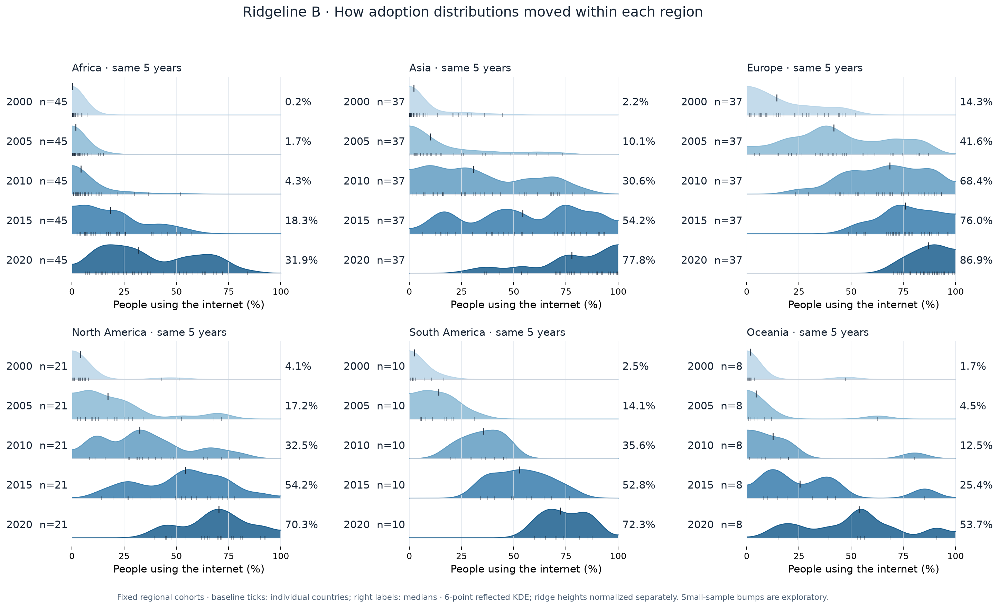

**Question.** Which regional differences are hidden by the whole-panel distribution?

**Encoding.** Each panel repeats the ridgeline view within one region for 2000, 2005, 2010, 2015 and 2020. All panels use the same internet-use scale. Country ticks and median labels help check the smooth curves.

**Why this chart.** The global distribution mixes countries from different regions. Small multiples repeat the ridgeline comparison within each region, so a broad global shape can be traced to different regional paths. Shared horizontal scales keep low and high adoption in the same position across all panels.

**What it shows.** Europe's ridges move toward high adoption earlier, while later African ridges still occupy low and middle values. Asia's distributions remain broad during its movement to the right. These distinct positions and widths explain how the global progress pattern combines different regional histories rather than one common shift.

The shared horizontal scale and unchanged country membership support temporal comparison inside each region. The small Oceania sample contains only eight included countries, making its individual ticks more reliable evidence than a smooth bump alone. Peak height is normalized within each ridge and should not be compared as a population count. These panels recover both between-region timing and internal spread that a single regional median horizon compresses.

**Takeaway.** Global progress combines different regional histories and changing internal spreads. A single global ridge therefore cannot represent one shared journey. Country marks are essential when small groups make a smooth density shape look more certain than the observations support.

[View figure and interpretation online](https://aithal007.github.io/DV_assignment2/figures.html#fig17)

## Scalar fields and visual encodings

Controlled experiments hold measured weather fields fixed while varying palette, temporal normalization and contour representation.

### Figure 18. How color choices change the view.

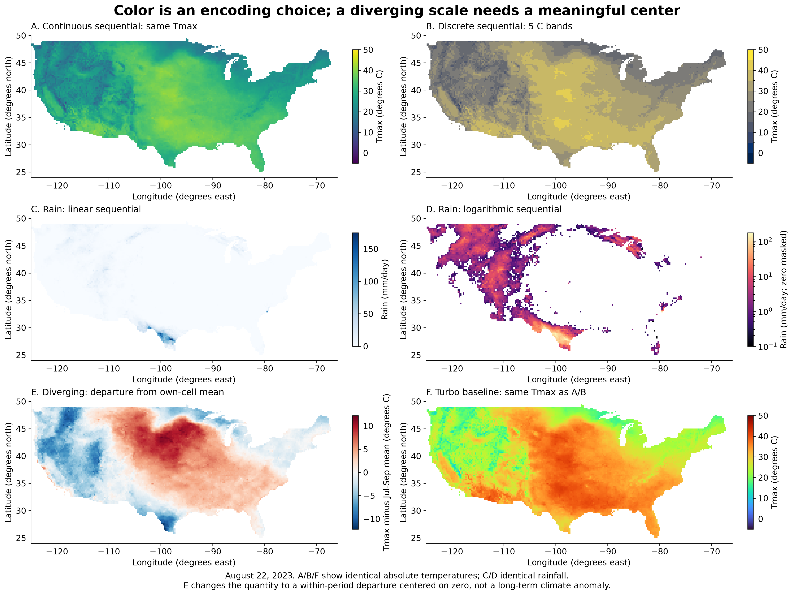

**Question.** What changes when the same field uses a different color mapping?

**Encoding.** The panels keep the weather field and date fixed. All four palettes are sequential colormaps: their colors progress from lower to higher values. Temperature uses continuous viridis and cividis split into 5°C bands. Rain uses Blues with a linear scale and magma with a logarithmic scale. Palette choice and scale normalization are separate choices. Read each color bar before comparing the maps.

**Why this chart.** A palette or scale can make a feature stand out even when the measurements do not change. These panels hold the field fixed and change only its mapping to color. Sequential colormaps suit these ordered magnitudes because no middle value needs special emphasis. Temperature tests palette choice; rainfall tests how the scale reveals smaller values alongside heavy rain.

**What it shows.** A/B/F encode the same August 22 absolute temperatures: continuous viridis, 5-degree cividis bands and a turbo baseline change visual emphasis without changing values. C/D similarly compare linear and logarithmic rainfall; zero rain is masked only for the logarithm. Ordered absolute magnitudes suit sequential palettes [7].

E deliberately changes the quantity to each cell's daily Tmax minus its own July-September mean. Zero now separates warmer/cooler departures, justifying symmetric RdBu_r. It is a within-period reference, not a climate normal. Keeping the quantity and normalization explicit prevents reading palette-induced contrast as additional physical structure; turbo hues have no extra measurement meaning.

**Takeaway.** Color mapping controls which measured differences receive visual emphasis. Linear rain color prioritizes absolute amounts, while logarithmic color separates small positive amounts. Interpret a feature through its legend and normalization before calling it a stronger weather event.

[View figure and interpretation online](https://aithal007.github.io/DV_assignment2/figures.html#fig18)

### Figure 19. Fixed and daily color scales.

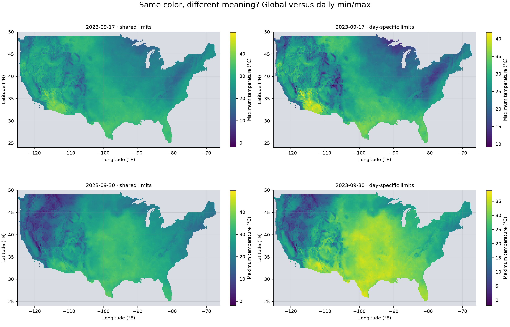

**Question.** Can the same color mean a different temperature?

**Encoding.** The left column uses one temperature range across the eight sampled dates. The right column rescales each date to its own minimum and maximum. Both columns show the same fields.

**Why this chart.** An animation can look equally warm on every date if each frame is rescaled separately. The two columns test this with identical daily fields. One scale preserves comparisons between dates; the other spends its full color range on the variation within each date. Neither choice can be understood without checking the color bars.

**What it shows.** The paired columns map identical daily fields using two parameter rules. Global normalization uses u=(T-min)/(max-min) with bounds fixed over the eight frames; daily normalization recomputes those bounds for each date. Consequently, the same warm hue may mark different temperatures in the daily column even when both frames use their full palette.

The fixed eight-date range is -1.85 to 49.65 C. It supports between-frame comparison without claiming to cover extremes on every unsampled day. Daily scaling is useful for within-date contrasts but cannot support reading repeated color as repeated absolute temperature. The GIFs make this issue explicit over time. This explains a visual inference failure that can occur before any statistical aggregation: inconsistent encodings can conceal the change the animation is meant to reveal.

**Takeaway.** Consistent colors are necessary for comparing temperature across dates. Daily rescaling can assign the same bright color to different temperatures, concealing absolute change. Use fixed bounds for temporal comparison and daily bounds for within-date contrast.

[View fixed-scale animation](https://aithal007.github.io/DV_assignment2/images/scivis/scivis_global.gif) | [View daily-scale animation](https://aithal007.github.io/DV_assignment2/images/scivis/scivis_local.gif)

### Figure 20. Contour intervals and filled contours.

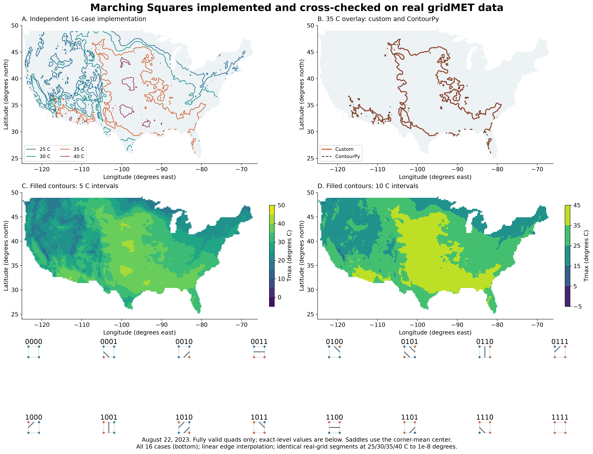

**Question.** How much boundary detail does the contour interval show?

**Encoding.** A: independent line tracing. B: custom/ContourPy 35 C overlay. C/D: five-/ten-degree filled bands. Bottom: all 16 corner cases; orange corners are above threshold. The same fully valid quads and linear interpolation support the comparison.

**Why this chart.** Contours turn a continuous field into visible boundaries. Using the same date with two intervals separates the effect of boundary spacing from actual weather differences. Lines make threshold crossings explicit, while filled bands make broad areas easier to compare. The four panels test both choices on the same grid.

**What it shows.** The submitted code now includes an independent 16-case Marching Squares implementation: four corner bits classify each fully valid quad; linear interpolation locates edge crossings; saddle cases use the corner-mean center. Exact-level values count as below. The bottom diagrams expose all cases, including the ambiguous patterns [6].

The custom lines match ContourPy serial at 25, 30, 35 and 40 C to 1e-8 degrees on the actual August 22 grid; 32 synthetic case/center checks also pass. The overlay shows agreement. Custom line tracing supports exact threshold inspection; ContourPy fills organize broad temperature bands and masked boundaries. Five- versus ten-degree bands change display detail, not source resolution. The code and machine-readable comparison are supplied.

**Takeaway.** More contour lines increase display detail without increasing data resolution. Five-degree spacing reveals more threshold crossings; filled bands emphasize broad regions. Select the representation for the reading task and infer boundaries only at the stated levels.

[View contour animation](https://aithal007.github.io/DV_assignment2/images/scivis/scivis_contour.gif)

## Weather across complete months and days

We restore all 92 dates to compare cooling, spatial spread, rainfall concentration, repeated heat and episode timing.

### Figure 21. Monthly temperature maps.

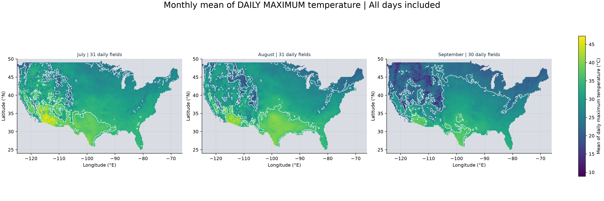

**Question.** How does the average daily maximum temperature change across the three months?

**Encoding.** Each map averages daily maximum temperature over one month. All maps use the same Celsius scale and the same 25°C and 35°C contour levels.

**Why this chart.** After testing color and contours, we use fixed choices to compare complete months. Shared colors let a temperature be recognized across all three maps, and common contour levels give reference boundaries. Using every day avoids choosing one unusually hot or cool date to represent a month.

**What it shows.** The same color and 25/35 C contours make monthly temperatures comparable. Mean daily maximum temperature falls from 31.19 C in July to 26.55 C in September over the weighted common footprint, while southern warm areas remain visible. The maps establish both the broad decline and its nonuniform spatial pattern.

Each month uses every daily maximum, so one unusually hot or cool day is not made its representative. The mapped quantity is an average of daily maxima, not a monthly extreme or an average of hourly temperatures. Monthly averaging still removes short spells and the order of days. The following difference map tests the spatial extent of cooling, and daily/frequency views recover the event information needed to interpret that seasonal summary.

**Takeaway.** The monthly maps establish broad cooling while retaining its spatial pattern. The mean daily maximum falls by 4.64 degrees, but a monthly average cannot count heat episodes or their duration. Daily and frequency views supply those missing dimensions.

[View figure and interpretation online](https://aithal007.github.io/DV_assignment2/figures.html#fig21)

### Figure 22. Monthly change versus two selected dates.

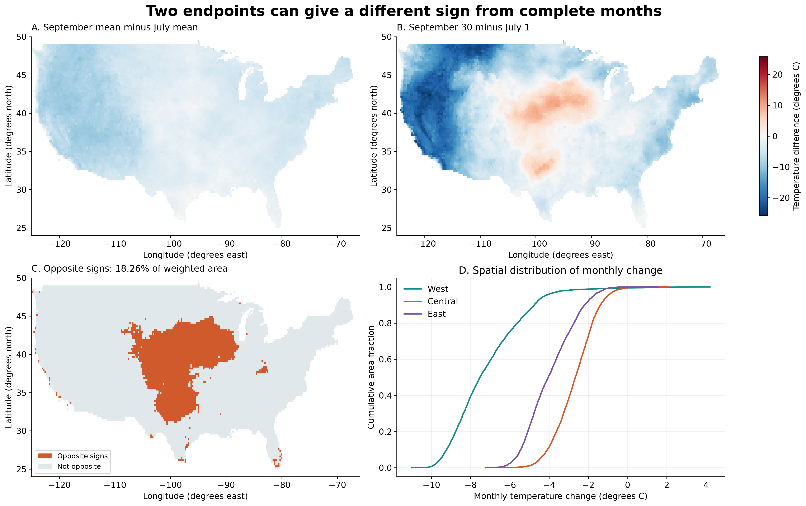

**Question.** Can two daily snapshots describe a whole month’s change?

**Encoding.** A: complete-month difference; B: September 30 minus July 1, with the same zero-centered limits. C: orange marks opposite signs. D: area-weighted cumulative distributions of monthly changes by longitude sector.

**Why this chart.** Three maps show overall cooling but make small spatial differences difficult to compare. A diverging colormap suits a difference map because zero is a meaningful reference: it separates cooling from warming. Symmetric color limits show the sign and size of change around that neutral center. The cumulative curves show how widespread each change is within longitude bands, rather than reducing each band to one mean.

**What it shows.** A/B use the same symmetric color limits for complete-month and endpoint changes. Monthly September-minus-July means cool over 99.66% of weighted area, with mean change -4.64 C. C directly marks the 18.26% where September 30 minus July 1 has the opposite sign. D shows how monthly cooling varies across longitude sectors.

Thus the endpoint discrepancy is now visible rather than only stated. Two selected weather states can misrepresent the direction of complete-month change at a location. Comparing matched footprints and a zero-centered diverging scale separates this sampling effect from a color-scale change; the cumulative curves prevent one area mean from concealing spatial variation.

**Takeaway.** Two endpoint days can misrepresent change across the full interval. Their change sign disagrees with the complete-month comparison over 18.26% of the study area. Use all days when the claim concerns monthly conditions rather than two weather states.

[View figure and interpretation online](https://aithal007.github.io/DV_assignment2/figures.html#fig22)

### Figure 23. Daily temperature and its spatial spread.

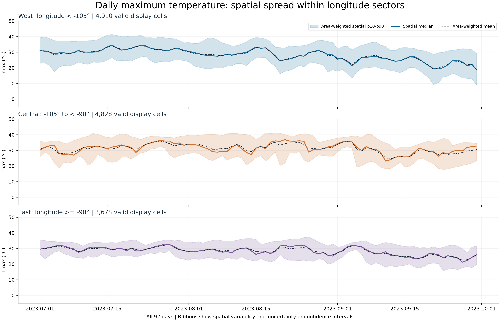

**Question.** What does a daily average hide about different places?

**Encoding.** Each longitude-sector panel retains all 92 days. The solid colored line is the area-weighted spatial median, the dashed dark line the area-weighted mean, and the shaded ribbon the spatial 10th-90th percentiles. All panels use the same Celsius scale.

**Why this chart.** Monthly averages hide both short episodes and differences between places. A daily line restores timing, while the ribbons retain the range of temperatures across locations. Separate longitude panels keep the regional patterns readable without overlaying six shaded bands on one set of axes.

**What it shows.** On July 27, the western sector's weighted Tmax mean is 31.193 C and its spatial p10-p90 range is 23.75-39.25 C. The central mean is 35.36 C with range 31.39-38.35 C. The western daily value is distinct from July's all-area mean, 31.192 C: both round to 31.19, a numerical coincidence verified from the cache.

Solid lines show spatial medians, dashed lines weighted means, and ribbons spatial p10-p90. Fixed sector memberships are 4,910/4,828/3,678 cells. Their different ribbon widths show why similar summary trajectories need not imply similar conditions across places. The ribbons describe spatial spread, not uncertainty around a mean.

**Takeaway.** A smooth area mean can conceal both daily episodes and simultaneous differences between places. The ribbons recover that spatial spread around the daily mean. Their width describes variation across cells, rather than statistical uncertainty about the mean.

[View figure and interpretation online](https://aithal007.github.io/DV_assignment2/figures.html#fig23)

### Figure 24. Monthly rain totals and five-day bursts.

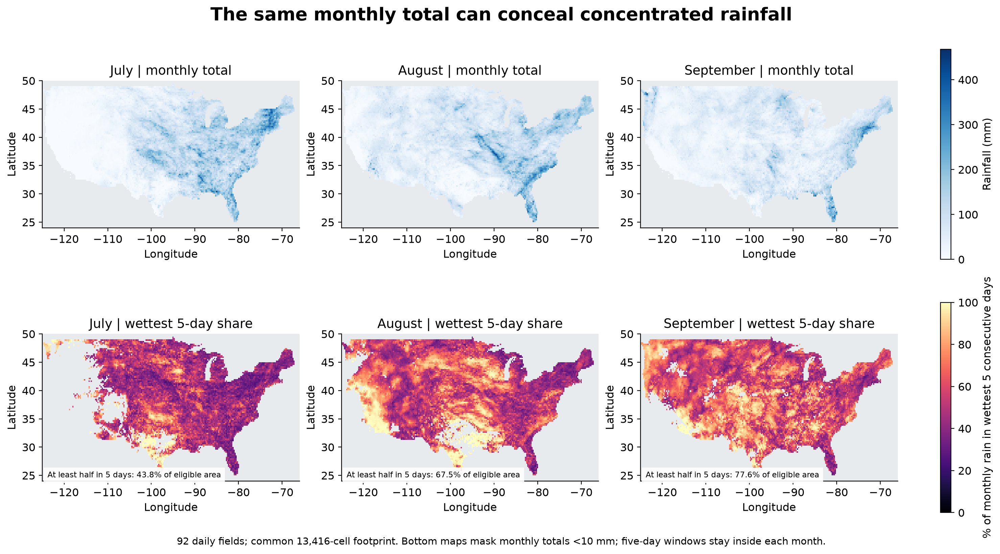

**Question.** Can similar monthly totals come from different rainfall timing?

**Encoding.** The top row shows monthly rain totals on one scale. The bottom row shows the share of each month’s rain that falls in its wettest five consecutive days. Cells with less than 10 mm monthly rain are masked in the bottom row.

**Why this chart.** A monthly rainfall total cannot distinguish steady rain from a short burst. The second row adds the share falling in the wettest five consecutive days. Keeping total and concentration separate avoids calling a very small rain amount a major event simply because all of it fell at once.

**What it shows.** July and August have similar weighted rain totals, 75.26 and 75.82 mm, but different timing. Among cells with monthly total at least 10 mm, 43.8% of eligible July area gets at least half its rain in one five-day window, versus 67.5% in August and 77.6% in September. September's total is lower, 57.08 mm.

The minimum-total mask avoids ratios dominated by tiny denominators; eligible footprints differ (74.75%, 92.32%, 94.09%). Concentration also depends on wet-day count: a cell with few rain days can have a large five-day share without a sustained episode. Read the ratio with totals and daily timing, rather than interpreting it directly as event duration or hazard.

**Takeaway.** Monthly rainfall amount cannot identify how rain arrived. Similar July-August totals conceal different five-day concentration, and September has the largest concentration share despite a lower total. Compare amount with timing, using the explicitly eligible area for each month.

[View figure and interpretation online](https://aithal007.github.io/DV_assignment2/figures.html#fig24)

### Figure 25. Where hot days are frequent.

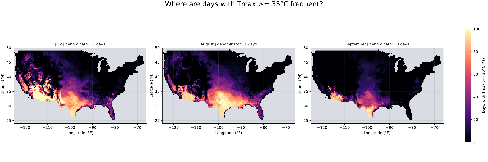

**Question.** Where do daily maximum temperatures often reach 35°C?

**Encoding.** Each map shows the percentage of days in a month with daily maximum temperature at least 35°C. The three maps share one 0–100% scale.

**Why this chart.** A monthly mean temperature does not count how often a chosen hot threshold was exceeded. Frequency maps use all days and preserve location, making repeated heat distinguishable from one selected hot day. The fixed percentage scale lets July, August and September be compared directly.

**What it shows.** The weighted mean frequency of Tmax >=35 C falls from 22.8% of July days to 8.9% of September days. The spatial colors show where repeated threshold exceedance remains concentrated, providing evidence that is absent from the monthly mean temperature alone.

The denominator is each month's number of days, so 31 versus 30 days does not mechanically create the contrast. A 50% cell crosses the chosen threshold on half its days, but its warm days may be consecutive or scattered. Thus these maps establish repetition and location, while the persistence map/calendar establish sequence and duration. The 35 C threshold is a declared descriptive definition rather than a universal heat-risk criterion; the final sensitivity panel checks how that choice affects the counts.

**Takeaway.** Hot-day frequency reveals repeated heat that a monthly mean or one selected date cannot count. Its decline from July to September measures occurrence, while the maps retain location. Frequency still leaves the ordering of those days unresolved.

[View figure and interpretation online](https://aithal007.github.io/DV_assignment2/figures.html#fig25)

### Figure 26. Hovmoller diagrams: daily departures and rain across longitude.

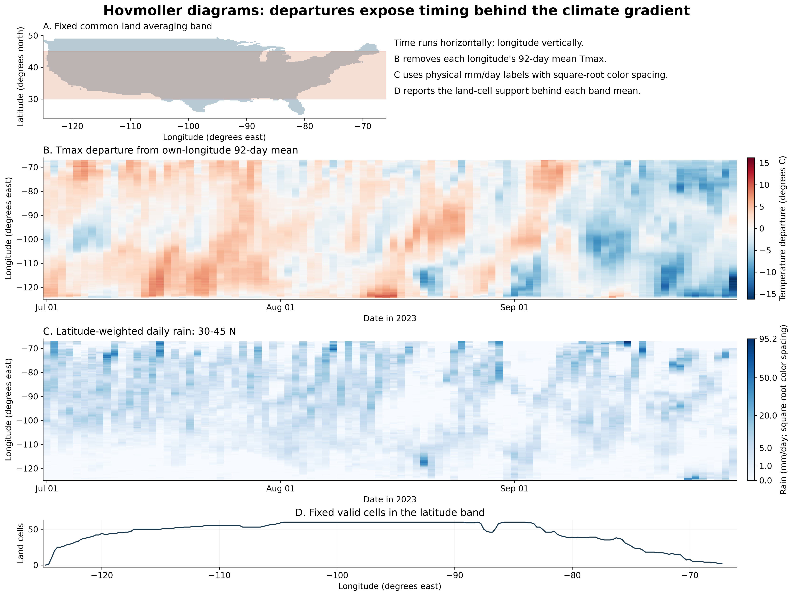

**Question.** When and where do warm and rainy periods occur?

**Encoding.** A identifies the fixed 30-45 N band. In B/C, horizontal position is date and vertical position longitude. B shows departure from each longitude's own period mean; C shows actual rain with square-root color spacing. D gives the contributing-cell count.

**Why this chart.** Maps preserve location but require many frames to show all 92 days. A time-longitude diagram keeps every date visible in one view. Averaging across latitude makes room for that time axis, so episodes can be compared by their dates and east-west extent rather than remembered across an animation.

**What it shows.** This Hovmoller-style display retains daily time-longitude structure [11]. Time is horizontal and longitude vertical; A locates the 30-45 N averaging band. B subtracts each longitude's own 92-day mean Tmax, removing the fixed east-west baseline so within-period warm/cool departures are visible. The reference is not a long-term climate normal.

C's largest latitude-weighted rain mean is 95.20 mm/day on September 16 at 67.27 W. It averages only two valid coastal cells, with 94.10 and 96.30 mm/day; the units are verified, not square-root millimeters. Only color spacing is square-root transformed. D exposes longitude support (1-60 cells). Sparse support can preserve local extremes; these aggregate streaks do not track individual storms.

**Takeaway.** Retaining every date exposes episodes smoothed away by monthly maps. The time-longitude view locates their timing and east-west extent, but latitude averaging removes north-south detail. Return to maps before interpreting a band as a specific event location or track.

[View figure and interpretation online](https://aithal007.github.io/DV_assignment2/figures.html#fig26)

## Wind direction and magnitude

Quiver maps locate the flow; monthly direction distributions describe how often different winds occur.

### Figure 27. Quiver: readable sampling and arrow-length comparisons.

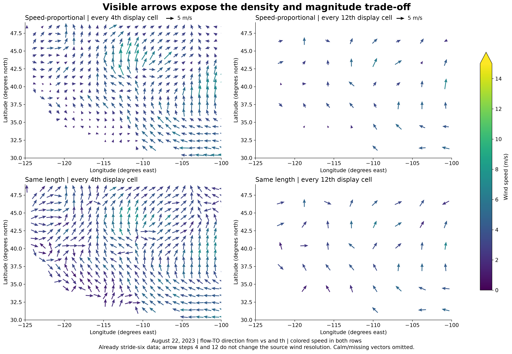

**Question.** How do sampling and arrow length affect readability?

**Encoding.** Columns sample every fourth/twelfth point of the already stride-six cache. Upper arrows have speed-proportional lengths; lower arrows have equal lengths. Color shows speed in both rows; keys identify the upper physical scale.

**Why this chart.** An arrow map can become unreadable before it becomes informative. Holding the wind field fixed while varying spacing shows how much local detail is traded for legibility. Comparing speed-scaled and equal-length arrows also separates the tasks of reading direction and reading magnitude.

**What it shows.** Two readable sampling densities now compare every fourth and twelfth display cell on the same August 22 western-US field. Larger speed-proportional arrows retain a 5 m/s key; equal-length arrows prioritize direction while color still encodes speed. Dense sampling can overlap; sparse sampling removes locations rather than smoothing the field.

The required variables are `vs` (10 m speed) and `th` (10 m FROM-direction). After angle conversion to radians, u=-vs*sin(th), v=-vs*cos(th) gives flow-TO components. Display bearings account for longitude scale and map aspect. The comparison isolates symbol density and length encoding; it cannot reveal finer wind resolution or trajectories absent from the data [1].

**Takeaway.** Arrow spacing and length determine which wind questions are readable. Sparse sampling clarifies directions while omitting locations; equal lengths emphasize direction and speed-scaled lengths add magnitude. Interpret the vector convention and speed colors with the chosen design.

[View figure and interpretation online](https://aithal007.github.io/DV_assignment2/figures.html#fig27)

### Figure 28. Monthly wind-direction distributions.

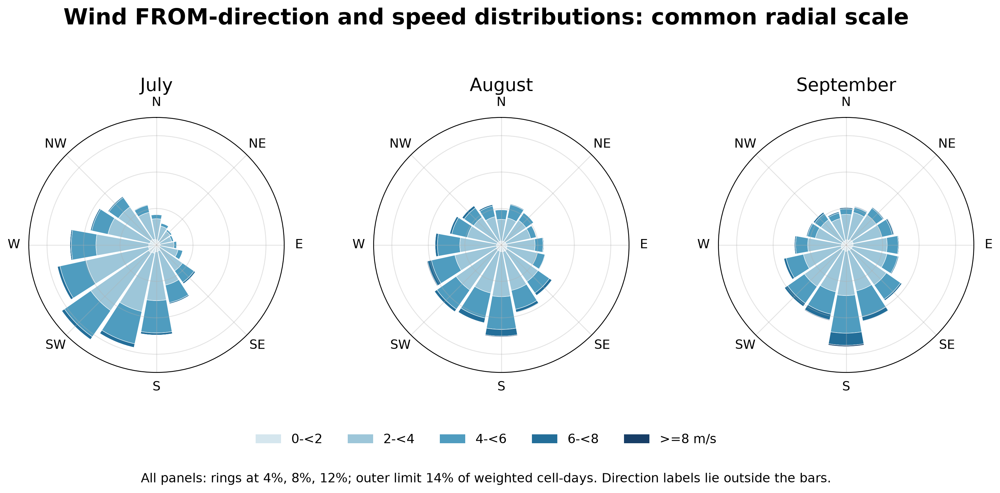

**Question.** Does one pooled wind summary hide monthly differences?

**Encoding.** Each rose groups a month’s grid-cell days by wind source direction. Stacked colors show speed ranges. The same radial scale gives the percentage of each month’s weighted grid-cell days.

**Why this chart.** Quiver maps show where wind points, but not how often each source direction occurs across a month. Wind roses collect those directions into sectors and divide each sector by speed. Separate monthly panels and a common radial scale reveal changes that one pooled seasonal rose would hide.

**What it shows.** July's largest source-direction sector is southwest, shifting toward south in August/September. All roses use the same 14% outer limit; ring values are stated outside the bars so labels no longer cover measurements. Stacked colors show how speed classes contribute to each directional frequency.

Each percentage uses weighted grid-cell days in that month, not just days at one station. Equal radial scales make the seasonal shift comparable, while the common legend prevents color reinterpretation. This pooled direction distribution complements the quiver maps: it reveals frequency changes but deliberately gives up exact location.

**Takeaway.** Wind direction and strength distributions change within the three-month interval. Monthly roses expose a source-direction shift that a pooled seasonal summary could hide. Their common radial scale supports frequency comparison, while maps remain necessary to locate the winds.

[View figure and interpretation online](https://aithal007.github.io/DV_assignment2/figures.html#fig28)

## Coincidence, frequency and persistence

Aligned fields identify joint conditions, full-period counts establish occurrence, and the daily calendar explains why equal frequencies can have unequal run lengths.

### Figure 29. Temperature, rain and wind on the same dates.

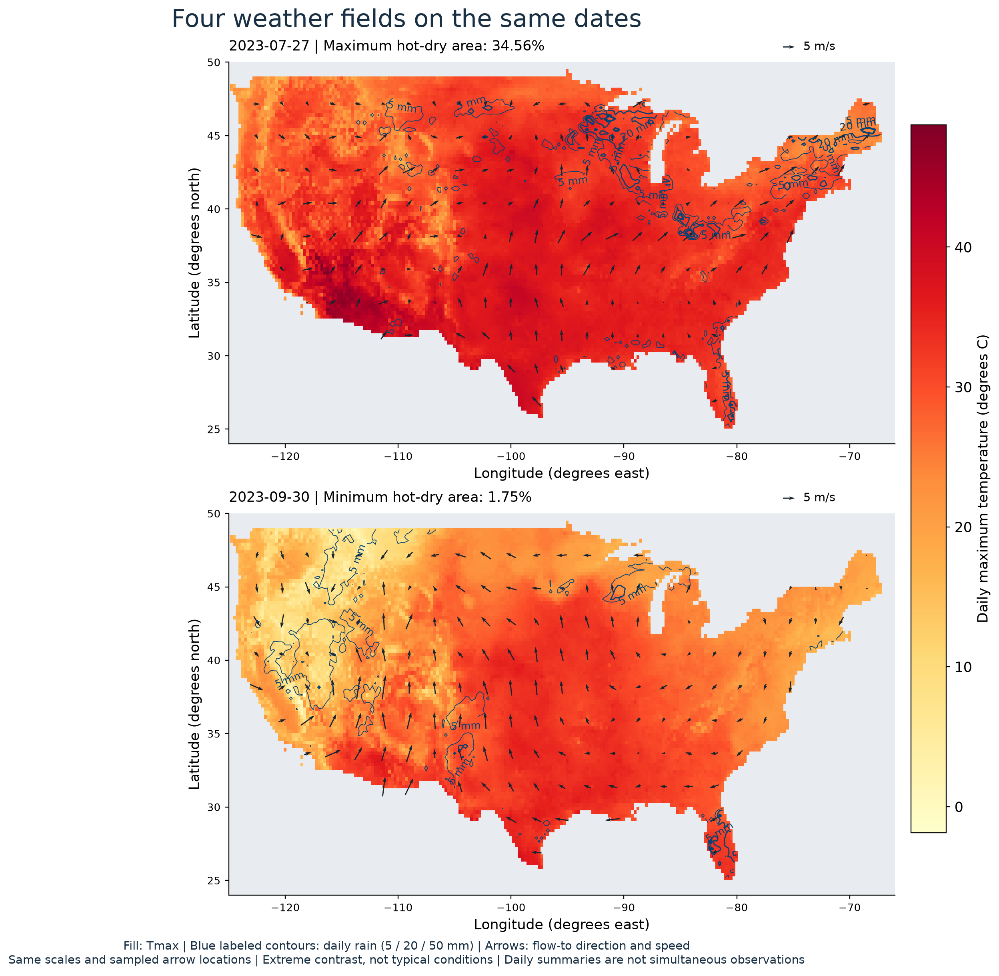

**Question.** Can separate weather summaries hide where conditions occur together?

**Encoding.** Both maps combine temperature color, rain contours and wind arrows. They show July 27 and September 30 on shared scales so the fields can be read at the same locations.

**Why this chart.** Separate temperature, rainfall and wind maps make it hard to check whether conditions occur at the same locations. The overlay aligns the three fields on one map. Two contrasting dates show what that alignment adds, while common visual scales keep the comparison meaningful.

**What it shows.** The objectively selected dates contrast hot-dry area coverage of 34.56% on July 27 and 1.75% on September 30. Common temperature colors, 5/20/50 mm rain contours and the same arrow positions permit spatial comparison. The overlay reveals where the fields coincide; three separate area means would not establish that.

The dates are deliberately contrasting examples, so they do not show how frequent either state is. The next full-period calculation evaluates all cells and dates. Moreover, daily maximum temperature, accumulated rain and daily wind summaries need not occur at the same hour: the overlay establishes cell-day alignment, not instantaneous physical simultaneity. This qualification preserves the spatial inference without turning co-location into an explanation of a weather mechanism.

**Takeaway.** Separate field summaries cannot establish that conditions coincide at the same place. The overlay aligns heat, rain and wind to reveal spatial coincidence on selected dates. Those examples motivate the complete-period overlap calculation rather than establish its frequency.

[View figure and interpretation online](https://aithal007.github.io/DV_assignment2/figures.html#fig29)

### Figure 30. Separate frequencies and shared occurrence.

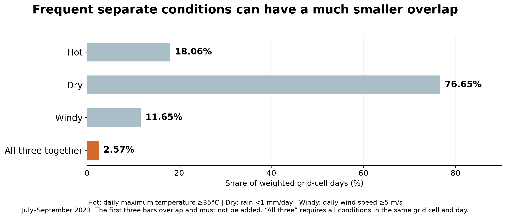

**Question.** How often do hot, dry and windy conditions occur together?

**Encoding.** The first three bars count hot, dry and windy grid-cell days separately. The orange bar requires all three conditions in the same grid cell on the same day. All bars use the same weighted percentage scale.

**Why this chart.** With three conditions and a question about their joint occurrence, four bars give a direct answer. The first three establish how common each condition is; the fourth requires all three together. An intersection matrix would add symbols and combinations that are unnecessary for this comparison.

**What it shows.** The separate bars give about 18.06% hot, 76.65% dry and 11.65% windy weighted cell-days. Their intersection is 2.57%, calculated only when all three flags are true at the same cell and date. A very common dry condition therefore does not make the three-condition event equally common.

The bars overlap and must not be added. Multiplying the three marginal percentages would give about 1.61% under an independence assumption, rather than the measured 2.57%; separate frequencies do not recover the joint distribution. This answers the coincidence part of the main question with an explicit joint calculation. It is not a significance test, causal attribution or official hazard index, and neighboring cells/days are not independent samples.

**Takeaway.** Common individual conditions need not produce common joint events. Although dry days occupy 76.65% of weighted cell-days, only 2.57% meet all three conditions together. Compute overlap at the same cell and date; separate marginal percentages cannot recover it.

[View figure and interpretation online](https://aithal007.github.io/DV_assignment2/figures.html#fig30)

### Figure 31. How often conditions occur and how long they last.

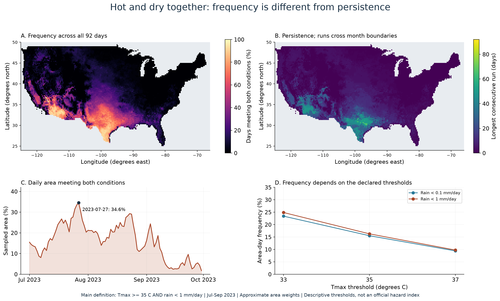

**Question.** Does the event count describe uninterrupted duration?

**Encoding.** The maps compare hot-dry day frequency and the longest hot-dry run at each cell. The daily curve shows area coverage. The final panel repeats the calculation under alternative thresholds.

**Why this chart.** The shared-condition bars count occurrences but do not show whether they form long uninterrupted spells. Frequency and longest-run maps separate these two ideas. The daily coverage curve restores timing, and the threshold panel checks how the numerical result changes when the event definition changes.

**What it shows.** Hot-dry conditions occupy 16.27% of weighted grid-cell days, while the maximum local uninterrupted run reaches 67 days. These quantities have different denominators: one summarizes area and time together; the other records the longest sequence at one location. The daily coverage curve adds whether a local persistent pattern also affects a large fraction of the footprint at once.

The final panel repeats frequencies at 33, 35 and 37 C with rain cutoffs of 0.1 and 1 mm/day, showing definition sensitivity. Runs touching the first/last observation may continue outside the window. The daily calendar that follows supplies a direct explanation of the frequency-persistence distinction: equal counts can be arranged into very different spells. Report occurrence, duration, coverage and threshold together before characterizing the event pattern.

**Takeaway.** Occurrence, uninterrupted duration and affected area describe different event properties. The 16.27% hot-dry frequency and 67-day local maximum cannot substitute for each other. Combine their maps, daily coverage and threshold sensitivity before characterizing the seasonal pattern.

[View figure and interpretation online](https://aithal007.github.io/DV_assignment2/figures.html#fig31)

### Figure 32. Daily event order separates frequency from persistence.

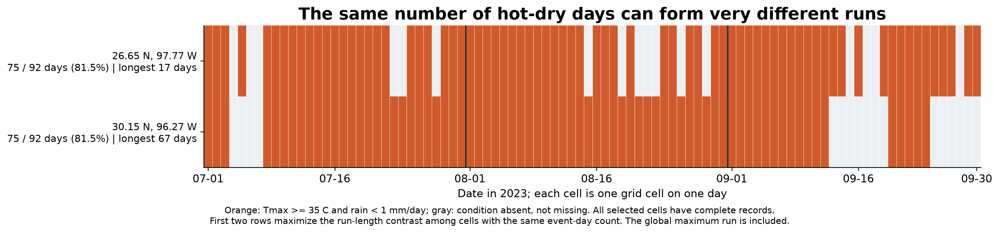

**Question.** Can equal event frequencies hide different uninterrupted spells?

**Encoding.** Rows are named grid cells; columns are all 92 days. Orange marks hot-dry conditions and gray their absence. Row labels give event-day counts and longest runs; vertical lines separate months.

**Why this chart.** Maps show where frequency and persistence occur. The calendar reveals the daily ordering that creates their difference.

**What it shows.** Both selected cells have 75 qualifying days out of 92 (81.5%), yet the orange sequences form longest runs of 17 and 67 days. The interrupted first row and long continuous block in the second supply the visual mechanism behind that difference. A count discards the ordering that determines persistence.

Selection searches the common 13,416-cell footprint for the largest run-length contrast among equal positive day counts, with a declared tie rule. These are deliberately diagnostic examples, not typical cells. The maximum 67-day run is included. Fixed coordinates and the complete daily series avoid changing locations or omitting non-event days between panels. Boundary-touching spells may extend beyond the study window. This is the temporal detail needed to interpret the preceding frequency and run-length maps.

**Takeaway.** Equal event counts can hide very different persistence. Two cells each have 75 hot-dry days, yet longest spells of 17 and 67 days. Preserving daily order is necessary to distinguish scattered occurrences from sustained conditions.

[View figure and interpretation online](https://aithal007.github.io/DV_assignment2/figures.html#fig31)

## Discussion

Country averages conceal profile differences (71 of 454 nearly equal-adoption pairs meet P95), different paired paths, and the 47% within-region variation. Broadband association weakens from 0.83 for levels to 0.05 for gains, with ceiling/diffusion effects limiting interpretation. Layouts preserve edges while changing crossing costs; omitting one indicator gives Jaccard 0.338-0.512, exposing feature sensitivity despite small-noise stability.

Weather comparisons recover different omitted details: endpoint signs disagree with monthly means over 18.26% of area; totals conceal concentrated rainfall; equal 75-day event counts produce 17- versus 67-day runs. Separate field frequencies also fail to recover the 2.57% joint occurrence. These findings answer the main question through profiles, matched change and daily order.

**Scope and limits.** Country aggregates support descriptive comparisons, not causal attribution. Complete-case cohorts exclude missing observations; counts, shares and subscription rates use different denominators. Weather results concern one three-month interval and a fixed subsampled footprint, with approximate area weights and dependent cells/days. Daily fields need not coincide hourly; runs may extend beyond the window. Event cutoffs are descriptive, and period departures are not climate normals. Stride six reduces processing volume and display overlap; no native-resolution equivalence is claimed.

## Code and supporting files

The README supplies setup and staged reproduction commands. Source country extracts, weather caches/acquisition metadata, custom contour code/tests, numbered images and editable LaTeX are included. The local launcher opens the UIs; optional Playwright commands regenerate browser exports and complete captures.

## Author contributions and task allocation

Task responsibilities are assigned below.

| Member | Responsibility |
|---|---|
| Parikshith Aithal K V (BT2024249) | Network and interactive parallel coordinates; scalar color mapping and global/local scales. Figs. 1-6, 12, 18-19, 21-23. |
| Sindhoor Ganapathi Hegde (BT2024014) | Horizon/ridgeline variations; custom contour tracing, filled bands and contour GIF. Figs. 13-17, 20, 25-26, 31-32. |
| Varshith M Gowda (BT2024227) | Zoomable treemap remodels/partitioning; quiver sampling and length encoding. Figs. 7-11, 24, 27-30. |

## Conclusion

Similar internet-use levels can come with different infrastructure histories. Regional progress can leave countries far apart. Similar monthly rain totals can arrive steadily or in a burst, and frequent events need not form long runs.

Each stage adds the detail missing from the previous summary: links and values, annual paths and distributions, daily timing and shared conditions.

## References

1. J. T. Abatzoglou, "Development of gridded surface meteorological data for ecological applications and modelling," International Journal of Climatology, vol. 33, pp. 121-131, 2013. gridMET product and documentation. [Online source](https://www.climatologylab.org/gridmet.html).

2. Our World in Data, "Internet" and underlying ITU/World Bank indicator metadata. The report uses the preserved A1 extracts, not a newly downloaded release. [Online source](https://ourworldindata.org/internet).

3. A. A. Hagberg, D. A. Schult and P. J. Swart, "Exploring network structure, dynamics, and function using NetworkX," Proceedings of the 7th Python in Science Conference, pp. 11-15, 2008. [Online source](https://aric.hagberg.org/papers/hagberg-2008-exploring.pdf).

4. D3 contributors, "What is D3?" and hierarchy/treemap documentation. JavaScript library used for the browser visualizations. [Online source](https://d3js.org/what-is-d3).

5. M. Bastian, S. Heymann and M. Jacomy, "Gephi: An Open Source Software for Exploring and Manipulating Networks," ICWSM, 2009. Assignment-permitted alternative; not used in this implementation. [Online source](https://doi.org/10.1609/icwsm.v3i1.13937).

6. ContourPy contributors, "Algorithm description," serial marching-squares/sweep contour generation and interpolation documentation. [Online source](https://contourpy.readthedocs.io/en/stable/description.html).

7. Matplotlib contributors, "Choosing Colormaps in Matplotlib," sequential and diverging palette guidance. [Online source](https://matplotlib.org/stable/users/explain/colors/colormaps.html).

8. N. Henry, J.-D. Fekete and M. J. McGuffin, "NodeTrix: A Hybrid Visualization of Social Networks," IEEE TVCG, vol. 13, no. 6, pp. 1302-1309, 2007. [Online source](https://www.dgp.toronto.edu/~mjmcguff/research/nodetrix/nodetrix.pdf).

9. NOAA National Centers for Environmental Information, "Assessing the U.S. Climate in July 2023," 2023. Independent context for the Southwest heat episode in the selected year. [Online source](https://www.ncei.noaa.gov/news/national-climate-202307).

10. J. Heinrich et al., "Evaluation of a Bundling Technique for Parallel Coordinates," 2011. Inspiration for the explicit-group, axis-preserving browser curves. [Online source](https://arxiv.org/abs/1109.6073).

11. E. Hovmoller, "The Trough-and-Ridge diagram," Tellus, vol. 1, no. 2, pp. 62-66, 1949. [Online source](https://doi.org/10.3402/tellusa.v1i2.8498).